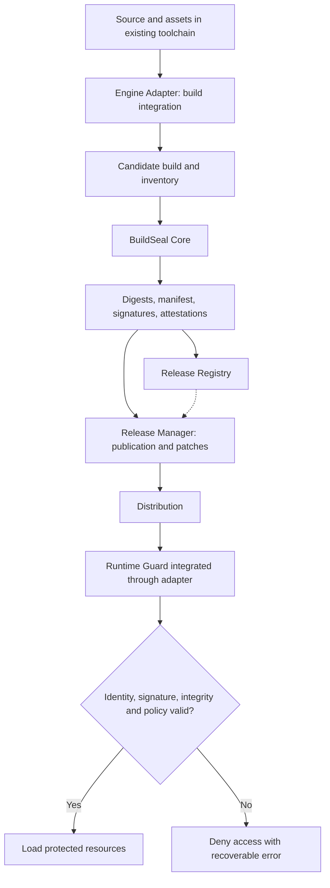

# BuildSeal — Abstract and Technical Feasibility Report

**Version:** 0.2 — discussion document for peer review  
**Date:** 30 October 2026  
**Status:** pre-development proposal; no prototype or benchmarks completed  
**Audience:** cybersecurity, reverse engineering, software supply-chain security, applied cryptography, game development and distribution professionals  
**Scope:** BuildSeal, a hybrid release-protection, attestation and management system. A complementary but distinct application for promotional-media protection is also outlined.

> **Purpose.** Present the proposal rigorously, separating agreed design directions from technical hypotheses and known limitations. The goal is to invite competent criticism **before** implementation begins. This is not a white paper describing an existing product, nor a claim of unbreakable protection.

## Abstract

The growing availability of generative AI, asset-extraction tools and reverse-engineering techniques can reduce the effort required to reproduce, reuse or redistribute parts of a video game. Independent developers are especially exposed: they need to publicize games early to attract attention, collect wishlists and reach their audience, but often have limited resources to respond to opportunistic copies or unauthorized redistribution. The problem includes at least two distinct scenarios: **(a)** reconstructing a game by observing screenshots or gameplay videos, even without obtaining the original software; and **(b)** analyzing and modifying an actual distributed, playable build.

**BuildSeal** primarily targets the second scenario. It is conceived as a **release security toolchain**: a mandatory checkpoint in the promotion of every baseline, patch and hotfix, combining an **engine-agnostic core** with **engine-specific adapters** that integrate security checks into packaging and runtime resource loading. Every official artifact receives a layered identity (project, release and optionally distribution), an authenticated manifest, cryptographic digests, provenance attestations and references to a verifiable update lineage. Its more ambitious hypothesis is to link access to selected resources essential to gameplay to the validity of the release identity, using a Runtime Guard and selective cryptographic protection.

The intended outcomes are to **detect unauthorized changes, reject inconsistent component combinations in the official execution path, improve forensic traceability and raise the cost of opportunistic abuse**. The system cannot guarantee that an attacker with full client control will be unable to bypass checks or extract data and keys made available during execution. Nor can it prevent conceptual reconstruction from a preview. That separate risk motivates a **second experimental application** focusing on robust watermarking, media provenance and controlled multimodal-model interpretation tests.

This report outlines an initial threat model, architecture, possible cryptographic building blocks, release state machine, experimental criteria and open questions for independent reviewers. **The desired outcome is not validation by enthusiasm, but the discovery of weak assumptions, fundamental limitations and components better served by existing standards.**

## 1. Problem statement and objectives

The underlying tension is between an independent developer's need to display work in progress and the risk of third parties reproducing its content, appearance or behavior. Rather than attributing all such activity broadly to “AI,” the relevant attack paths should be separated:

| Scenario | Attacker's available material | Potential result | Scope |
|---|---|---|---|
| Preview-based reconstruction | Screenshots, trailers, recorded gameplay | Independently recreated visuals or functionality | Media application; **not** BuildSeal |
| Asset reuse | Sprites, textures, audio, extracted packages | Copying or transforming original content | Both projects, through different mechanisms |
| Reverse engineering | Executable, packages, assets, running process | Extraction, modification or repackaging | **BuildSeal** |
| Tampered distribution | Official builds and patches | Mixed versions, counterfeit packages, altered updates | **BuildSeal** |
| Gameplay-mechanic recreation | Observed and described rules | New implementation without original files | No guaranteed direct technical protection |

**BuildSeal's primary goals:**

1. Make every official release **identifiable and independently verifiable**, provided that the verifier trusts the signer's key.
2. Introduce an explicit **sealing and promotion** stage for baselines, patches and hotfixes.
3. Preserve a verifiable **release lineage** and validate permitted state transitions during updates.
4. Add **runtime verification** that conditions ordinary access to selected protected resources on package consistency.
5. Support forensic **project, release and distribution markers**, while separating technical indications from legal proof.
6. Remain practical for independent teams: cost, overhead and maintenance must be proportionate to the benefit.

**Non-goals:** claiming unbreakable DRM; protecting an abstract gameplay idea; punitive file deletion; undisclosed telemetry; automatically identifying the person responsible for a leak; indiscriminate blocking of VMs or debuggers; replacing platform security controls or copyright law.

## 2. Design premise: an official release is a certified artifact

Successful compilation is not the same as an official release. BuildSeal introduces a separate step: **a candidate build becomes distributable only after explicit verification, sealing and authorized registration**. Every subsequent change, however small, results in a new Release ID; a patch cannot impersonate an earlier version merely by renaming files or directories.

The original concept of “identification files that do not implement gameplay themselves, yet are necessary for it to run” is refined into two separate functions:

- **Forensic function:** identifiers, digests, attestations and release links support recognition and provenance analysis. Individual forensic markers do not all need to be execution-critical.
- **Enforcement function:** the official runtime validates signed materials and, for selected resources, may require valid cryptographic material before granting access. Merely checking a boolean or file existence is insufficient; the check should be integrated with the actual resource-loading pathway.

These functions may share a registry, but should not be confused: **a hash identifies content, a signature authenticates a statement relative to a key, and encryption temporarily protects confidentiality; none of them alone guarantees the behavior of a modifiable client**.

## 3. Proposed hybrid architecture



**BuildSeal Core.** Engine-independent component, ideally exposing a CLI, responsible for inventories, hashing, manifest creation and verification, attestations, selected content packaging and signing. It does not need to understand game mechanics.

**Engine Adapters.** Plugins or SDKs for engines such as Godot, Unity, Unreal, custom runtimes and HTML5. They connect pre-/post-build hooks, discover assets and loading points, declare target capabilities and integrate the Runtime Guard. Engine differences introduce different limits; compatibility must not be presumed.

**Runtime Guard.** A library or runtime component that checks a trust root, validates manifests and resource-loading policy, reports errors and authorizes selected resource access. It can itself be modified and inspected on the attacker's device: **it is not an absolute root of trust**.

**Release Registry.** Local or remote registry for Project IDs, Release IDs, digests, certificates, attestations and release relationships. It supports auditing and verification. Tamper-evident properties may be strengthened with append-only or transparency logs; an ordinary database record should not be mistaken for a trusted timestamp.

**Release Manager.** Governs authorized promotion, distribution channels, patches, atomic updates, recovery, intentional rollbacks, revocation and cross-version compatibility.

**Overall design:** a common Core, stable interfaces, target-specific adapters and declarative policies; adapters must never claim stronger protection than the target platform supports.

## 4. Layered identity and provenance

| Identifier | Lifetime | Meaning |
|---|---|---|
| **Project ID** | Stable throughout development | Logical identity of the product, associated with one or more authorized public keys |
| **Release ID** | New for each sealed artifact | Identity of the specific build, manifest and associated attestations |
| **Distribution ID** | Optional, per batch/channel/tester | Forensic hint to differentiate distributed packages; does not automatically identify an individual |

**Additional candidate fields:** source commit (where appropriate and non-sensitive), declared builder and environment, SHA-256 file digests, signing algorithm and key ID, asset inventory, authorized parent Release IDs, manifest schema version, policy, target platform and adapter capabilities, optional trusted timestamps.

Forensic references may be replicated across different package locations to improve their chances of surviving partial modification. An attacker can still remove them or recompile the application. Finding a marker establishes at most a **technical association that requires context**: it does not automatically assign personal liability or establish copyright ownership.

**Illustrative manifest only (not a finalized schema):**

```json
{
  "schema_version": "draft-0.1",
  "project_id": "urn:uuid:<project-uuid>",
  "release_id": "urn:uuid:<release-uuid>",
  "version": "1.0.1",
  "target": "windows-x64",
  "parent_release_ids": ["urn:uuid:<previous-release-uuid>"],
  "signing_key_id": "developer-key-01",
  "files": [
    {"path": "assets/core.pack", "sha256": "<hex-digest>", "protected": true}
  ],
  "attestation_ref": "<attestation-reference>"
}
```

Signatures must cover a **canonical and unambiguous representation** of the payload, without recursive references (the manifest must not include the hash of its own signature). Canonicalization, paths, symlinks, optional files, digest encodings, verification APIs and key rotation/revocation remain to be specified.

## 5. Cryptographic dependency and runtime enforcement

The central hypothesis is to make some **gameplay-essential resources** accessible only through a validated loading path. A possible laboratory workflow is:

1. At sealing time, the Core computes digests and signs an inventory.
2. It packages selected resources in an authenticated encrypted container (for example using **AES-GCM**, with correct nonce uniqueness and key management).
3. The Runtime Guard validates the signature, trust root, Release ID, compatibility policy and resource integrity.
4. The loader obtains or derives a content key according to the chosen policy, then decrypts/authenticates the resource before handing it to the engine.
5. If checks fail, **the official runtime** does not provide protected resources; it returns a clear, recoverable error and offers a repair path. **It does not delete files.**

Three protection profiles are proposed for separate evaluation:

- **Standard (offline):** manifests, signatures, digests, independent verification and consistent updates. Main benefits: integrity and provenance.
- **Protected (offline):** Standard plus selective encryption and a Runtime Guard. Raises the effort required for trivial extraction but does not prevent recovery of plaintext data in memory or modification of checks.
- **Connected (optional):** authorization or key material delivered by a remote service. Can keep **some secrets** off the client or move **some operations** server-side, but creates connectivity dependence, operational costs and potential legitimate-user lockout.

**Fundamental limitation:** in an offline model, the client must hold or derive the material needed to decrypt content it uses. An attacker with full device control can attempt to observe keys and plaintext at the moment they are available. A proprietary container format plus a custom “translator” or loader may increase extraction costs; **it cannot eliminate this structural limit**. Platform attestation, hardware-backed isolation and remote attestation change the trust model only on supported platforms, with specific trade-offs.

## 6. Release lifecycle, patches and updates

**Proposed states:** `Development → Candidate → Verified → Sealed → Released`, with distinct handling for rejected, revoked, superseded and intentionally rolled-back releases. `Verified` requires explicit checks; `Sealed` refers to an immutable signed artifact; `Released` requires an authorized distribution decision.

Each patch declares at least the **expected source state**, **destination state**, **artifact digests**, **compatibility constraints** and a **valid signature**. The intended update process is: pre-validation → staging → verification of resulting state → atomic activation where feasible → recovery of the last known-good version after failure. Unauthorized mixing of components from different releases must be detected.

To address rollback, freeze, mix-and-match and compromised update repositories, BuildSeal should **investigate integration with TUF** rather than implement an improvised security-sensitive updater. **in-toto, SLSA and Sigstore** should be assessed for provenance and attestation. BuildSeal signing does not replace operating-system or distribution-store code signing.

## 7. Threat model and trust boundaries

**Assets at risk:** official release identity, patch authenticity, proprietary assets, package integrity, private signing keys, attestations and the game's availability to legitimate users.

**Threat actors:** opportunistic asset extractor; redistributor of modified packages; motivated reverse engineer with complete client control; adversary able to tamper with update hosting; insider with partial pipeline access. These actors differ in capability and cost.

**Key trust boundaries:**

- **Build machine / CI:** a compromised build system or signer may produce malicious but validly signed output. Access control, auditing and signing-key isolation matter.
- **Registry / update host:** metadata is not inherently trustworthy simply because it comes from the project's server. Clients need authentication and freshness guarantees under an appropriate policy.
- **End-user client:** **untrusted** under the strong threat model. The attacker may inspect memory, replace files, modify verifiers and analyze network traffic.
- **Authorization service:** can protect secrets or logic not distributed to clients, but introduces availability, credential-abuse and privacy concerns.

**Attacks the official path should detect:** modified file, forged manifest, untrusted key, patch from the wrong parent release, swapped resource, cross-version mix and unauthorized downgrade. **Attacks it cannot promise to stop:** Guard removal, memory dumping, clean-room recreation, modification of local verification logic, visual cloning without original assets, or supply-chain compromise upstream of signing.

## 8. Ethical, operational and privacy constraints

An early idea involved disabling a tampered package by deleting its files. This is **rejected as a product mechanism**: it is destructive, can trigger on false positives and does not provide dependable resistance. The intended behavior is to **fail closed only for protected resources**, with a clear error, repair options and preservation of user data.

The proposal excludes hidden hardware or OS-serial collection, invasive device fingerprinting, undisclosed identification pings, or treating virtual machines as proof of hostile activity. VMs, debuggers and accessibility tools all have legitimate uses. Any platform-integrity checks must be disclosed, proportionate, optional when practical and subject to legal and privacy review.

Further requirements include: no mandatory online-only mode for Standard; consideration of long-term game availability and service shutdown; explicit namespaces for permitted mods; careful measurement of performance, accessibility, support burden, modding and game preservation impact.

## 9. Platform-specific constraints

| Environment | Potential capabilities | Main limitations |
|---|---|---|
| Native Windows/Linux/macOS | Signing, digests, integrated loader, selective encryption | Inspectable client; platform-specific tools and formats |
| Unity/Godot/Unreal | Build adapter and runtime integration | Maintenance across engine versions and different pipelines |
| Custom game engine | Deeper resource-manager integration | SDK and developer integration work required |
| HTML5/browser | Manifest, integrity, inventory, conditional access where meaningful | Required JS/WASM and assets are delivered into an inspectable environment |
| Online with trusted backend | Keys, operations or critical state retained server-side | Cost, latency, uptime, privacy and maintenance |

**Proposed rule:** the Core should expose an explicit *capabilities* model. Each adapter must declare which controls it can actually implement. A request for unavailable protection must be rejected or explicitly downgraded, never represented as equivalent security.

## 10. Complementary project: preventive media and preview protection

Reconstruction from screenshots or videos calls for **a separate application** with its own research methods and success metrics. The proposed tool would prepare media for publication with an **asset identifier, developer attribution reference, signed provenance, optional trusted timestamp and invisible watermark**. The watermark should carry a compact pointer to a verifiable registry rather than duplicating all metadata.

The experimental work asks whether, and under what conditions, multimodal reconstruction pipelines can be influenced by **signals or messages embedded in content**, low-visibility image perturbations or properties of encoding and compression. Research must start with the *actual ingestion path*: original file, metadata, decoder, normalization, platform transcoding and the representation eventually presented to the model. We must not assume that a model receives every original byte, reads metadata or treats instructions in third-party media as authoritative.

**Hypotheses requiring tests, not established capabilities:** watermark survival after transcoding; recognition of a hidden payload; measurable impact on reconstruction fidelity; robustness to cropping, scaling and screen capture. Deliberately malformed data intended to break external tools is not treated as a reliable protection method or proposed product feature. Any adversarial tests must take place in isolated, authorized settings.

**Potential synergy with BuildSeal:** Project IDs, provenance registries, attestation structure, potentially identity signing keys and a shared asset history. **Separation:** success in watermark retrieval does not establish runtime security, and a signed executable does not prevent its gameplay mechanics from being independently reconstructed from a video.

For media, standards such as **C2PA** already address provenance, distinguishing cryptographically exact content binding from more flexible associations using perceptual fingerprints or watermarks. They should be assessed as interoperability foundations, not as magic anti-copy mechanisms.

## 11. Experimental plan before full development

| Phase | Experiment | Expected evidence / question |
|---|---|---|
| **0 — Peer review** | Threat model, boundaries, comparison with existing approaches | Which assumption is wrong or redundant? |
| **1 — Provenance MVP** | Minimal test game, manifest, signature, independent verifier | Are substitution, tampering and untrusted keys consistently detected? |
| **2 — Protected MVP** | Encrypted asset, loader and Guard in an authorized test runtime | How costly is bypassing the official path? When is data in plaintext? |
| **3 — Update MVP** | Baseline A, patch A→B, forged patch, A/B mixing and interrupted update | Are security and recovery adequate? |
| **4 — Adapter** | One real engine adapter, then HTML5 for contrast | How much of the Core is genuinely universal? |
| **5 — Media (separate)** | Images/videos, compression, watermarking and authorized multimodal tests | Are there reproducible effects beyond traceability? |

**Essential metrics:** false positives and negatives in checks; file coverage; build, startup, memory and frame-time overhead; time and tools required to bypass an **authorized prototype**; marker persistence after transformations; recovery success; adapter integration and maintenance costs; offline availability. No numerical protection claims should be made before benchmarking.

**Go/no-go criteria:** if Protected offers no meaningful measurable improvement over signing + independent verification + secure updates, or causes excessive legitimate-user failures, it should be reduced or dropped. Even if anti-extraction proves uneconomical, BuildSeal may still be valuable as a **release-security and forensic-provenance system**.

## 12. Questions for external reviewers

1. Does binding a gameplay-essential resource to a signed manifest make sense when the client is fully under attacker control?
2. Which checks should be independent of the runtime, and which can reasonably live inside the engine?
3. What does selective encryption genuinely add beyond code signing, hashes and a secure updater?
4. How can baseline, patch, authorized rollback and revocation lineage be modeled unambiguously?
5. What should be the first realistic bypass test on an authorized PoC, and what cost should be measured?
6. Which elements of TUF, in-toto, SLSA and Sigstore should be adopted instead of reimplemented?
7. What minimum signing-key management is acceptable for an indie studio without an HSM or dedicated infrastructure?
8. What limitations do game stores, platforms and mainstream engines impose on this approach?
9. How can the Runtime Guard avoid breaking permitted mods, development tools, accessibility and software preservation?
10. Do Distribution IDs provide enough forensic value to justify per-recipient packaging and attribution risks?
11. Which experimental outcomes should cause us to **stop** working on the anti-tamper profile?
12. If media-based techniques do not reliably influence AI models, could provenance and watermarking still form a useful separate product?

## 13. Agreed directions, open decisions and first deliverable

**Design directions already discussed:** two distinct but potentially interoperable applications; BuildSeal integrated into the build/release lifecycle; hybrid architecture with a common Core and engine adapters; layered identities; fresh identities for every baseline and patch; integrity and provenance verification; selective functional dependency on protected resources; non-destructive failure; expert review before code.

**Open decisions after review:** target for the first PoC; manifest format; trust root; signing and timestamping model; key-management strategy; degree of online enforcement; concrete algorithms and container formats; adapter APIs; resource granularity; modding policy; store compatibility; project license and governance.

**Suggested first deliverable:** a reviewer-amended architecture, an agreed threat model and a minimal comparison experiment covering **(A)** signature and independent verifier, **(B)** A + Guard and selective offline encryption, and **(C)** B + optional remote authorization. Findings must report failures and side effects as carefully as successes.

## 14. Technical references

The following are relevant standards or sources of engineering guidance. Their inclusion **does not imply that BuildSeal implements or conforms to them**.

- **The Update Framework (TUF):** [official specification](https://theupdateframework.github.io/specification/v1.0.36/) — trustworthy updates and rollback/freeze/mix-and-match protections.
- **in-toto Attestation Framework:** [specification and repository](https://github.com/in-toto/attestation) — process and artifact attestations.
- **SLSA Build Provenance:** [specification](https://slsa.dev/spec/v1.0/provenance) — build origin and execution context.
- **Sigstore:** [documentation](https://docs.sigstore.dev/) — artifact and attestation signing and verification.
- **OWASP MASVS-RESILIENCE:** [reference](https://mas.owasp.org/MASVS/11-MASVS-RESILIENCE/) — role and limits of anti-tamper, obfuscation and anti-debugging.
- **NIST SP 800-38D:** [Galois/Counter Mode (GCM)](https://csrc.nist.gov/pubs/sp/800/38/d/final) — authenticated encryption.
- **RFC 3161:** [Time-Stamp Protocol](https://www.rfc-editor.org/rfc/rfc3161) — trustworthy third-party timestamping.
- **C2PA:** [official specifications](https://spec.c2pa.org/specifications/) — media provenance, content binding and watermarking.

---

**Request for review.** The most valuable feedback identifies a false precondition, an overlooked attack, an existing standard worth reusing, an underestimated operational cost or a minimal experiment capable of falsifying a hypothesis. The objective is to decide **whether**, and **which parts**, are worth building before building them.
