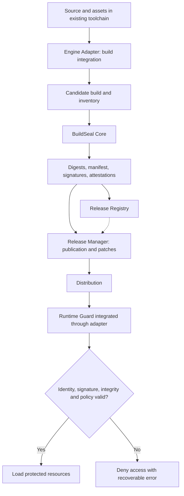

# BuildSeal — Abstract and Technical Feasibility Report

**Version:** 0.3 — discussion document for peer review\
**Date:** 30 October 2026  
**Status:** pre-development proposal; no prototype or benchmarks completed  
**Audience:** cybersecurity, reverse engineering, software supply-chain security, applied cryptography, game development and distribution professionals  
**Scope:** BuildSeal, a release identity, provenance and integrity proposal, with experimental runtime protection and separate media research.

> **Purpose.** Present the proposal rigorously, separating agreed design directions from technical hypotheses and known limitations. The goal is to invite competent criticism **before** implementation begins. This is not a white paper describing an existing product, nor a claim of unbreakable protection.

## Abstract

BuildSeal is a proposal for a **release identity, provenance and integrity toolchain for independent games**. Its intended core connects inventories, signed manifests, attestations and baseline/patch/hotfix lineage through an engine-independent Core and engine adapters. The value to validate is making existing security practices accessible and consistent in indie pipelines. Cryptographic novelty and commercial usefulness are not established.

The primary problem is recognizing official artifacts, detecting changes and inconsistent combinations, and documenting provenance. Signatures and attestations do not certify that a build is harmless: a compromised pipeline can sign malicious content. Independent verification and a modifiable runtime have different trust boundaries.

An optional, experimental **Protected** profile asks whether selective encryption and a Runtime Guard raise practical extraction costs beyond native engine protections. It does not guarantee permanent secrecy or enforcement on a fully attacker-controlled client. Connected changes the trust boundary only for secrets and operations actually retained server-side. Reconstruction from screenshots and videos is outside BuildSeal's protection promise; media provenance and watermarking belong to separate research.

Revision 0.3 incorporates peer-review concerns: key origins, dynamic dumping, collusion between copies, reusable extractors, channel-specific adoption and update costs. **No prototype, benchmark or protection result exists yet.** The aim is to decide what merits an experiment and what should be dropped.

## 1. Problem statement and objectives

The underlying tension is between an independent developer's need to display work in progress and the risk of third parties reproducing its content, appearance or behavior. Rather than attributing all such activity broadly to “AI,” the relevant attack paths should be separated:

| Scenario | Attacker's available material | Potential result | Scope |
|---|---|---|---|
| Preview-based reconstruction | Screenshots, trailers, recorded gameplay | Independently recreated visuals or functionality | Media application; **not** BuildSeal |
| Asset reuse | Sprites, textures, audio, extracted packages | Copying or transforming original content | Both projects, through different mechanisms |
| Reverse engineering | Executable, packages, assets, running process | Extraction, modification or repackaging | **BuildSeal** |
| Tampered distribution | Official builds and patches | Mixed versions, counterfeit packages, altered updates | **BuildSeal** |
| Gameplay-mechanic recreation | Observed and described rules | New implementation without original files | No guaranteed direct technical protection |

**BuildSeal's primary goals:**

1. Make every official release **identifiable and independently verifiable**, provided that the verifier trusts the signer's key.
2. Introduce an explicit **sealing and promotion** stage for baselines, patches and hotfixes.
3. Preserve a verifiable **release lineage** and validate permitted state transitions during updates.
4. Add **runtime verification** that conditions ordinary access to selected protected resources on package consistency.
5. Support forensic **project, release and distribution markers**, while separating technical indications from legal proof.
6. Remain practical for independent teams: cost, overhead and maintenance must be proportionate to the benefit.

**Non-goals:** claiming unbreakable DRM; protecting an abstract gameplay idea; punitive file deletion; undisclosed telemetry; automatically identifying the person responsible for a leak; indiscriminate blocking of VMs or debuggers; replacing platform security controls or copyright law.

## 2. Design premise: an official release is a certified artifact

Successful compilation is not the same as an official release. BuildSeal introduces a separate step: **a candidate build becomes distributable only after explicit verification, sealing and authorized registration**. Every subsequent change, however small, results in a new Release ID; a patch cannot impersonate an earlier version merely by renaming files or directories.

The original concept of “identification files that do not implement gameplay themselves, yet are necessary for it to run” is refined into two separate functions:

- **Forensic function:** identifiers, digests, attestations and release links support recognition and provenance analysis. Individual forensic markers do not all need to be execution-critical.
- **Enforcement function:** the official runtime validates signed materials and, for selected resources, may require valid cryptographic material before granting access. Merely checking a boolean or file existence is insufficient; the check should be integrated with the actual resource-loading pathway.

These functions may share a registry, but should not be confused: **a hash identifies content, a signature authenticates a statement relative to a key, and encryption temporarily protects confidentiality; none of them alone guarantees the behavior of a modifiable client**.

## 3. Proposed hybrid architecture



**BuildSeal Core.** Engine-independent component, ideally exposing a CLI, responsible for inventories, hashing, manifest creation and verification, attestations, selected content packaging and signing. It does not need to understand game mechanics.

**Engine Adapters.** Plugins or SDKs for engines such as Godot, Unity, Unreal, custom runtimes and HTML5. They connect pre-/post-build hooks, discover assets and loading points, declare target capabilities and integrate the Runtime Guard. Engine differences introduce different limits; compatibility must not be presumed.

**Runtime Guard.** A library or runtime component that checks a trust root, validates manifests and resource-loading policy, reports errors and authorizes selected resource access. It can itself be modified and inspected on the attacker's device: **it is not an absolute root of trust**.

**Release Registry.** Local or remote registry for Project IDs, Release IDs, digests, certificates, attestations and release relationships. It supports auditing and verification. Tamper-evident properties may be strengthened with append-only or transparency logs; an ordinary database record should not be mistaken for a trusted timestamp.

**Release Manager.** Governs authorized promotion, distribution channels, patches, atomic updates, recovery, intentional rollbacks, revocation and cross-version compatibility.

**Overall design:** a common Core, stable interfaces, target-specific adapters and declarative policies; adapters must never claim stronger protection than the target platform supports.

## 4. Layered identity and provenance

| Identifier | Lifetime | Meaning |
|---|---|---|
| **Project ID** | Stable throughout development | Logical identity of the product, associated with one or more authorized public keys |
| **Release ID** | New for each sealed artifact | Identity of the specific build, manifest and associated attestations |
| **Distribution ID** | Optional, per batch/channel/tester | Forensic hint to differentiate distributed packages; does not automatically identify an individual |

**Additional candidate fields:** source commit (where appropriate and non-sensitive), declared builder and environment, SHA-256 file digests, signing algorithm and key ID, asset inventory, authorized parent Release IDs, manifest schema version, policy, target platform and adapter capabilities, optional trusted timestamps.

Forensic references may be replicated across different package locations to improve their chances of surviving partial modification. An attacker can still remove them or recompile the application. Finding a marker establishes at most a **technical association that requires context**: it does not automatically assign personal liability or establish copyright ownership.

**Collusion and marker transplantation.** Comparing differentiated copies can reveal variable fields, enable removal or replacement, or produce hybrid copies. A simple Distribution ID is not collusion-resistant fingerprinting. Test cross-copy comparison, transplantation and marker loss; collusion-resistant codes would require separate research on payload, copy count and false positives. No marker automatically establishes personal responsibility.

**Illustrative manifest only (not a finalized schema):**

```json
{
  "schema_version": "draft-0.1",
  "project_id": "urn:uuid:<project-uuid>",
  "release_id": "urn:uuid:<release-uuid>",
  "version": "1.0.1",
  "target": "windows-x64",
  "parent_release_ids": ["urn:uuid:<previous-release-uuid>"],
  "signing_key_id": "developer-key-01",
  "files": [
    {"path": "assets/core.pack", "sha256": "<hex-digest>", "protected": true}
  ],
  "attestation_ref": "<attestation-reference>"
}
```

Signatures must cover a **canonical and unambiguous representation** of the payload, without recursive references (the manifest must not include the hash of its own signature). Canonicalization, paths, symlinks, optional files, digest encodings, verification APIs and key rotation/revocation remain to be specified.

## 5. Key management, cryptographic guarantees and experimental runtime protection

### 5.1 Separate guarantees

- **Hashes:** identify content against a trusted reference; alone they do not identify its producer.
- **Manifest signature:** authenticates a statement relative to a trusted signing key. The private signing key stays in the pipeline, separate from encryption keys; it is never shipped to the game.
- **Authenticated encryption (AEAD):** provides confidentiality and symmetric integrity under a secret key. An attacker who compromises that key can create new ciphertexts with valid tags; the tag is not a publicly verifiable producer signature.
- **Runtime Guard:** enforces policy in the official path, but a hostile client can modify or replace it. A valid signature does not force a modified verifier to obey it.

### 5.2 Key origin and availability

| Profile | Origin and availability | Guarantee and limit |
|---|---|---|
| Standard offline | No content key; public verification key shipped, private signing key retained in the pipeline | Integrity and provenance against an authentic trust root; local verifier can be replaced |
| Protected offline, laboratory hypothesis | Random content key generated at sealing; delivered or reconstructed by the loader using material available to the client | Barrier to immediate extraction; keys and plaintext remain recoverable under full client control |
| Optional Connected | Authorization secret or operation retained by a service; any content key delivered only after authorization | Delivered keys and data remain capturable; exclusively server-side material has a different trust boundary |

**Explicit minimal hypothesis for the first Protected PoC:** a random key per protected container, with a documented, deliberately inspectable local delivery mechanism. If embedded in the binary, test static key recovery; any obfuscation must be described as such. This is not an approved production scheme. Invasive machine identifiers remain excluded under §8.

Before implementation, specify generation, storage, delivery, lifetime in memory, failure handling, rotation and compromise scope. Do not ship a project-wide master when resource- or release-scoped keys suffice. Best-effort memory clearing does not guarantee that earlier copies were not observed.

### 5.3 Derivation and identity binding

A possible laboratory scheme uses **HKDF** with secret, random input keying material, an explicit salt and context. Project ID, Release ID, resource ID, format version and key purpose may be encoded into `info` using canonical, unambiguous length-delimited fields. **HKDF does not turn public data into a secret.** Code hashes, manifests and public signatures alone cannot create a confidential key.

The master stays in the pipeline; a client would receive only material needed for its content. This narrows compromise scope but does not make offline-decryptable resources permanently secret. Keep signing and encryption keys separate and do not derive secret keys from a published signature.

An experimental variant may bind derivation to code and manifest hashes: modifying measured bytes changes the result. Define which bytes are covered and avoid circular packaging dependencies. An attacker can use an intact copy, falsify the measurement or intercept the key. **Key-entanglement is a comparative hypothesis, not a new trust root.** Retain it only if it improves results over a simpler loader.

### 5.4 Nonces, algorithms and loading

AES-GCM requires uniqueness of the key–nonce pair for distinct messages, including retries, parallel builds and resealing. Derivation must include a content version or change the key when a resource changes; a resource name alone does not manage re-encryption safely. Define verifiable nonce-allocation rules, usage limits and rebuild tests. Never obtain deduplication through unsafe key/nonce reuse.

XChaCha20-Poly1305 has longer nonces useful for random allocation, but is not automatically nonce-misuse-resistant. AES-GCM-SIV is a separate candidate to assess for misuse resistance, with its own limits and library support to verify. The cited libsodium documentation is not assumed to establish AES-GCM-SIV support. No algorithm is finally selected.

The intended official path is: verify the signed manifest and container digests → check identity and compatibility → obtain the key → authenticate and decrypt → deliver to the resource manager. Context metadata may be authenticated as AAD; this neither makes it secret nor replaces the signature. Unauthenticated plaintext must not be exposed to the engine. Failure denies only the protected resource and supports repair without deleting user data. User errors must support recovery without exposing secrets; detailed diagnostics belong in development/support facilities. Reducing error detail is not a security boundary.

### 5.5 Priority attacks and packaging

Test static extraction, key interception, dumping at loader output, loader/Guard patching and verifier substitution. One hook may intercept many resources, but coverage depends on paths exercised: one recovered asset does not establish complete extraction. Framebuffer/audio capture recovers a usable representation, not necessarily the original files and project structure.

Metrics include first asset, complete extraction, fidelity, time to build an automated extractor and reuse across releases and games. Diversification may limit reuse, but its developer cost must also be measured.

**Compress before encryption** when compression is useful. Re-encrypting a large container with a new key or nonce may change many bytes and impair deltas and deduplication. Compare monolithic containers, separate resources and independently authenticated chunks; measure download bytes, staging space and patch time. Fresh release keys and reuse of unchanged encrypted chunks are competing choices that must be explicit. Chunked designs must also authenticate inventory, order and context to prevent unauthorized mixing.

## 6. Release lifecycle, patches and updates

**Proposed states:** `Development → Candidate → Verified → Sealed → Released`, with distinct handling for rejected, revoked, superseded and intentionally rolled-back releases. `Verified` requires explicit checks; `Sealed` refers to an immutable signed artifact; `Released` requires an authorized distribution decision.

Each patch declares at least the **expected source state**, **destination state**, **artifact digests**, **compatibility constraints** and a **valid signature**. The intended update process is: pre-validation → staging → verification of resulting state → atomic activation where feasible → recovery of the last known-good version after failure. Unauthorized mixing of components from different releases must be detected.

To address rollback, freeze, mix-and-match and compromised update repositories, BuildSeal should **investigate integration with TUF** rather than implement an improvised security-sensitive updater. **in-toto, SLSA and Sigstore** should be assessed for provenance and attestation. BuildSeal signing does not replace operating-system or distribution-store code signing.

## 7. Threat model and trust boundaries

**Assets at risk:** official release identity, patch authenticity, proprietary assets, package integrity, private signing keys, attestations and the game's availability to legitimate users.

**Threat actors:** opportunistic asset extractor; redistributor of modified packages; motivated reverse engineer with complete client control; adversary able to tamper with update hosting; insider with partial pipeline access. These actors differ in capability and cost.

**Key trust boundaries:**

- **Build machine / CI:** a compromised build system or signer may produce malicious but validly signed output. Access control, auditing and signing-key isolation matter.
- **Registry / update host:** metadata is not inherently trustworthy simply because it comes from the project's server. Clients need authentication and freshness guarantees under an appropriate policy.
- **End-user client:** **untrusted** under the strong threat model. The attacker may inspect memory, replace files, modify verifiers and analyze network traffic.
- **Authorization service:** can protect secrets or logic not distributed to clients, but introduces availability, credential-abuse and privacy concerns.

**Attacks the official path should detect:** modified file, forged manifest, untrusted key, patch from the wrong parent release, swapped resource, cross-version mix and unauthorized downgrade. **Attacks it cannot promise to stop:** Guard removal, memory dumping, clean-room recreation, modification of local verification logic, visual cloning without original assets, or supply-chain compromise upstream of signing.

## 8. Ethical, operational and privacy constraints

An early idea involved disabling a tampered package by deleting its files. This is **rejected as a product mechanism**: it is destructive, can trigger on false positives and does not provide dependable resistance. The intended behavior is to **fail closed only for protected resources**, with a clear error, repair options and preservation of user data.

The proposal excludes hidden hardware or OS-serial collection, invasive device fingerprinting, undisclosed identification pings, or treating virtual machines as proof of hostile activity. VMs, debuggers and accessibility tools all have legitimate uses. Any platform-integrity checks must be disclosed, proportionate, optional when practical and subject to legal and privacy review.

Further requirements include: no mandatory online-only mode for Standard; consideration of long-term game availability and service shutdown; explicit namespaces for permitted mods; careful measurement of performance, accessibility, support burden, modding and game preservation impact.

## 9. Platform-specific constraints

| Environment | Potential capabilities | Main limitations |
|---|---|---|
| Native Windows/Linux/macOS | Signing, digests, integrated loader, selective encryption | Inspectable client; platform-specific tools and formats |
| Unity/Godot/Unreal | Build adapter and runtime integration | Maintenance across engine versions and different pipelines |
| Custom game engine | Deeper resource-manager integration | SDK and developer integration work required |
| HTML5/browser | Manifest, integrity, inventory, conditional access where meaningful | Required JS/WASM and assets are delivered into an inspectable environment |
| Online with trusted backend | Keys, operations or critical state retained server-side | Cost, latency, uptime, privacy and maintenance |

**Proposed rule:** the Core should expose an explicit *capabilities* model. Each adapter must declare which controls it can actually implement. A request for unavailable protection must be rejected or explicitly downgraded, never represented as equivalent security.

## 10. Separate research on media provenance

Reconstruction from previews is **outside BuildSeal's protection scope**. Any media project will have its own proposal, threat model, experiments and go/no-go criteria. Only an interoperability boundary remains here: Project IDs, asset references and attestations may connect media to releases without conflating guarantees.

Signed provenance, C2PA and watermarking may be assessed for attribution and traceability, separately testing survival under metadata stripping, transcoding, cropping and screen capture. They do not automatically establish ownership or personal responsibility and do not prevent copying.

Research on perturbations or multimodal interpretation is not a promised feature, requirement or validation phase of BuildSeal. It requires authorized, reproducible, model- and pipeline-specific tests; an observed effect does not establish general robustness or reconstruction prevention.

## 11. Experimental plan and decision criteria

**Proposed order:** review and threat-model definition → small early Protected risk experiment → provenance MVP → updates where needed → real engine adapter. The early experiment limits investment in the weakest hypothesis; it does not replace correct signing and verification.

| Phase | Experiment | Evaluation criterion |
|---|---|---|
| 0 — Review and adoption | Define users, channels, verifiers and existing services | Is there a concrete problem the current pipeline leaves unresolved? |
| 1 — Early Protected comparison | Same game/assets: A ordinary package + signature/verifier; B A + native engine protection; C A + Guard and selective encryption | Does C add practical value over B? XOR may be an optional educational control only |
| 2 — Provenance MVP | Manifest, signature, untrusted key, substituted file, simulated builder compromise | Separate artifact integrity, signer authenticity and builder trustworthiness |
| 3 — Optional update MVP | A→B, mixed versions, rollback, revocation and interruption | Verification, recovery and download cost; avoid duplicating a store updater |
| 4 — Adapter | One real engine and an HTML5 comparison | Integration cost, actual capabilities and maintenance |
| Connected variant | Compare with C if justified | Which secrets/operations stay server-side and which become exposed again? |

**Three authorized attack paths:** static extraction without execution; dynamic dumping of loaded content; loader or verification patching. Use identical assets and declare skills, starting knowledge, source access, tools, hardware and time budget. Separate white-box and black-box assessment. Report failures and coverage limits; a timeout is a censored observation, not proof of unbreakability.

**Extraction metrics:** time to first asset and complete extraction; resource coverage and fidelity; effort and usability of an automated extractor; reuse across releases, projects and adapters; diversification effectiveness and developer cost. Also compare copies carrying different Distribution IDs and attempt marker removal/transplantation.

**Operational metrics:** false positives/negatives, startup, memory, frame time, build time, patch bytes relative to the native baseline, staging, recovery, permitted-mod compatibility and offline availability. Set acceptable thresholds with target developers before testing rather than inventing them after seeing results.

**Separate go/no-go decisions:** reduce or drop Protected if it fails to improve on the native baseline by the required amount or introduces unacceptable costs. Independently assess whether provenance and release management offer sufficient operational value: technical feasibility does not establish market demand. No protection percentage, crack time or superiority claim precedes measurement.

## 12. Questions for external reviewers

1. Does binding a gameplay-essential resource to a signed manifest make sense when the client is fully under attacker control?
2. Which checks should be independent of the runtime, and which can reasonably live inside the engine?
3. What does selective encryption genuinely add beyond code signing, hashes and a secure updater?
4. How can baseline, patch, authorized rollback and revocation lineage be modeled unambiguously?
5. What should be the first realistic bypass test on an authorized PoC, and what cost should be measured?
6. Which elements of TUF, in-toto, SLSA and Sigstore should be adopted instead of reimplemented?
7. What minimum signing-key management is acceptable for an indie studio without an HSM or dedicated infrastructure?
8. What limitations do game stores, platforms and mainstream engines impose on this approach?
9. How can the Runtime Guard avoid breaking permitted mods, development tools, accessibility and software preservation?
10. Do Distribution IDs provide enough forensic value to justify per-recipient packaging and attribution risks?
11. Which experimental outcomes should cause us to **stop** working on the anti-tamper profile?
12. Is the boundary with separate media research clear, and which provenance references alone merit interoperability?

## 13. Shared directions, open decisions and first deliverable

**Shared directions:** Core and adapters; layered identities; independently verifiable integrity and provenance; fresh identity for every sealed release; non-destructive failure; no covert telemetry; separate media research. Protected remains optional and experimental. The Release Manager is modular and must not replace adequate distribution services.

**Open decisions:** PoC target; manifest format and canonicalization; trust root/bootstrap; key generation, delivery and rotation; algorithms and containers; patch granularity/cost; Connected model; adapter APIs; modding; platform compatibility and future component licensing. This revision does not change the existing LICENSE file.

**First deliverable:** revised threat model, validated adoption matrix and preregistered protocol for the §11 A/B/C comparison, with a Connected variant if justified. Results must separate measured benefits, failures, side effects and untested hypotheses.

## 14. Technical references

The following are relevant standards or sources of engineering guidance. Their inclusion **does not imply that BuildSeal implements or conforms to them**.

- **The Update Framework (TUF):** [official specification](https://theupdateframework.github.io/specification/v1.0.36/) — trustworthy updates and rollback/freeze/mix-and-match protections.
- **in-toto Attestation Framework:** [specification and repository](https://github.com/in-toto/attestation) — process and artifact attestations.
- **SLSA Build Provenance:** [specification](https://slsa.dev/spec/v1.0/provenance) — build origin and execution context.
- **Sigstore:** [documentation](https://docs.sigstore.dev/) — artifact and attestation signing and verification.
- **OWASP MASVS-RESILIENCE:** [reference](https://mas.owasp.org/MASVS/11-MASVS-RESILIENCE/) — role and limits of anti-tamper, obfuscation and anti-debugging.
- **NIST SP 800-38D:** [Galois/Counter Mode (GCM)](https://csrc.nist.gov/pubs/sp/800/38/d/final) — authenticated encryption.
- **RFC 3161:** [Time-Stamp Protocol](https://www.rfc-editor.org/rfc/rfc3161) — trustworthy third-party timestamping.
- **C2PA:** [official specifications](https://spec.c2pa.org/specifications/) — media provenance, content binding and watermarking.

- **HKDF:** [RFC 5869](https://www.rfc-editor.org/rfc/rfc5869) — extract-and-expand key derivation; public context is not secret keying material.
- **AEAD APIs:** [libsodium documentation](https://doc.libsodium.org/secret-key_cryptography/aead) — algorithms, nonce requirements and implementation constraints.
- **AES-GCM-SIV:** [RFC 8452](https://www.rfc-editor.org/rfc/rfc8452) — nonce-misuse-resistant authenticated encryption; not a claim of implementation.

## 15. Adoption, verifiers and distribution channels

This matrix is an adoption hypothesis to validate with actual users and channel documentation, not a compatibility claim.

| Scenario | Who verifies and where | Value to demonstrate / duplication to avoid |
|---|---|---|
| CI and internal promotion | Builder, release engineer and independent verifier | Consistent inventories, attestations, approvals and identity; compromised CI remains a threat |
| Playtests and direct delivery | Studio, tester or external verifier with an authentic trust root | Package integrity and forensic correlation; updater only when needed |
| PC stores, including Steam or itch.io | Store for services actually offered; studio/reviewer for its own attestations | Verify services/APIs per channel; do not assume stores are equivalent or automatically supply producer signing |
| Consoles or managed platforms | Platform-authorized toolchain and mechanisms | Initial value in the internal pipeline; updater/Guard only where documentation and agreements allow |
| HTML5 | Pipeline, external verifier and browser loader | Integrity and provenance within the stated model; used code and data remain inspectable |

For each scenario document current cost, verifier users, authentic public-key acquisition, revocation behavior and benefit over existing services. TUF applies to a BuildSeal-managed update path when present; it is not mandated as a second updater over a store. No attestation automatically remedies builder or signing-key compromise.

## 16. Related work and required comparisons

| Family / primary source | Relationship to BuildSeal | Required comparison |
|---|---|---|
| [Godot PCK encryption](https://docs.godotengine.org/en/stable/engine_details/development/compiling/compiling_with_script_encryption_key.html) | Pack encryption with material available to the runtime | Native baseline for static extraction, dumping and integration cost |
| [Steam DRM](https://partner.steamgames.com/doc/features/drm) | DRM wrapper; Valve states its limits against motivated attackers | Separate access control, code protection and provenance |
| [SteamPipe](https://partner.steamgames.com/doc/sdk/uploading) | Packaging and updates; locality of changes matters | Encrypted/compressed patches, chunks and actual download bytes |
| [Denuvo / Irdeto](https://irdeto.com/video-games) | Commercial game-protection family | Objectives, integration and requirements; no assumed equivalence or superiority |
| [VMProtect](https://www.vmpsoft.com/vmprotect/overview) and [Themida / Oreans](https://www.oreans.com/products.php) | Code protection and resistance to analysis | Costs, compatibility and differences from inventory/attestation workflows |
| TUF, in-toto, SLSA, Sigstore (§14) | Updates, attestations and provenance | Reuse standards; identify the incremental value of engine integration |

Vendor sources describe features and goals, not independent benchmarks. Costs, false positives, overhead and bypasses of existing products require documented cases and comparable conditions; this revision assigns no unsupported values or incidents. It does not propose indiscriminate anti-VM or anti-debug controls contrary to §8.

## 17. Current license and future component boundaries

The repository contains a [GPL-3.0 LICENSE](LICENSE), which this revision **does not change**. The documentation describes future components, not a shipped SDK. Before accepting code or distributing a Guard, define licensing and boundaries for documentation, CLI/Core, adapters, runtime and dependencies.

The GPL allows commercial activity; combination with proprietary software is the issue to assess. The [GNU FAQ](https://www.gnu.org/licenses/gpl-faq.html#LinkingWithGPL) distinguishes linking into a combined work from using separate programs. Running a Core in a pipeline does not automatically make game files GPL; incorporating or linking GPL code requires a different assessment. LGPL, MPL, Apache or an explicit exception are options with different obligations, not interchangeable substitutes. None is implicitly adopted here. The choice must fit technical integration, distribution and dependency licenses.

---

**Request for review.** The most valuable feedback identifies a false precondition, an overlooked attack, an existing standard worth reusing, an underestimated operational cost or a minimal experiment capable of falsifying a hypothesis. The objective is to decide **whether**, and **which parts**, are worth building before building them.
