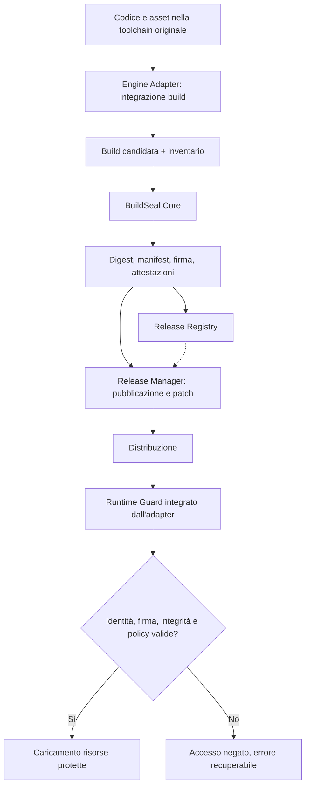

# BuildSeal — Abstract e rapporto tecnico di fattibilità

**Versione:** 0.2 — documento di discussione per peer review  
**Data:** 30 ottobre 2026  
**Stato:** proposta pre-sviluppo; nessun prototipo o benchmark ancora realizzato  
**Destinatari:** professionisti di cybersecurity, reverse engineering, software supply-chain security, crittografia applicata, sviluppo e distribuzione di videogiochi  
**Oggetto:** BuildSeal, sistema ibrido di protezione, attestazione e gestione delle release. Si descrive anche un applicativo complementare, distinto, per la protezione dei contenuti promozionali.

> **Scopo del documento.** Presentare la proposta nel modo più rigoroso possibile, distinguendo decisioni progettuali, ipotesi tecniche e limiti noti. Si richiede una critica competente **prima** della realizzazione del software. Non è un white paper di un prodotto esistente né una rivendicazione di inviolabilità.

## Abstract

La crescente disponibilità di strumenti di intelligenza artificiale generativa, di strumenti per l'estrazione di asset e di metodologie di reverse engineering può ridurre lo sforzo necessario a replicare, riutilizzare o ridistribuire parti di un videogioco. Gli sviluppatori indipendenti sono particolarmente esposti: devono mostrare presto i propri giochi per ottenere visibilità, raccogliere wishlist e accedere al mercato, ma dispongono di risorse limitate per contrastare copie opportunistiche o distribuzioni non autorizzate. Il problema include almeno due scenari distinti: **(a)** ricostruire un gioco osservando screenshot e video, anche senza avere l'originale; **(b)** analizzare e manipolare una build giocabile effettivamente distribuita.

**BuildSeal** risponde principalmente al secondo scenario. È concepito come una **release security toolchain**: un componente obbligatorio nel processo di promozione di ogni baseline, patch e hotfix, dotato di un **nucleo indipendente dal motore** e di **adattatori specifici** per integrare verifiche nel packaging e nel runtime. Ogni artefatto ufficiale riceve un'identità multilivello (progetto, release ed eventualmente distribuzione), un manifest autenticato, impronte crittografiche, attestazioni di provenienza e riferimenti a una catena di aggiornamenti verificabile. La proposta più ambiziosa consiste nel collegare, tramite un Runtime Guard e protezioni crittografiche selettive, l'accesso ad alcune risorse necessarie al funzionamento del gioco alla validità dell'identità di release.

Il sistema mira a **rilevare alterazioni, impedire combinazioni incoerenti di componenti nel percorso ufficiale, rafforzare la tracciabilità forense e aumentare il costo degli abusi opportunistici**. Non può garantire che un attaccante con controllo pieno del client non aggiri i controlli o estragga dati e chiavi disponibili durante l'esecuzione. Non impedisce la ricostruzione concettuale di un gioco da una preview. Quel rischio è oggetto di un **secondo applicativo sperimentale** dedicato a watermark robusti, provenienza dei media e test controllati di interpretazione da parte di modelli multimodali.

Il documento propone un modello di minaccia, una prima architettura, possibili scelte crittografiche, una macchina a stati per le release, criteri di prova e domande aperte per revisori esterni. **L'esito desiderato della peer review non è una conferma dell'idea, ma l'identificazione dei suoi punti di rottura e delle parti che conviene sostituire con standard esistenti.**

## 1. Origine del problema e obiettivi

Il problema nasce dalla tensione tra necessità di promuovere pubblicamente un videogioco ancora in sviluppo e rischio che terzi ne riproducano contenuti, aspetto o funzionamento. È utile classificare gli attacchi anziché attribuirli genericamente all'“AI”:

| Scenario | Materiale disponibile all'attaccante | Possibile risultato | Ambito |
|---|---|---|---|
| Ricostruzione da preview | Screenshot, trailer, gameplay registrato | Replica grafica o funzionale indipendente | Applicativo media; **non** BuildSeal |
| Riutilizzo di asset | Sprite, texture, audio, pacchetti estratti | Copia o trasformazione di contenuti originali | Entrambi, con meccanismi diversi |
| Reverse engineering | Eseguibile, pacchetti, asset, runtime | Estrazione, modifica o ripackaging | **BuildSeal** |
| Distribuzione alterata | Build e patch ufficiali | Mix di versioni, pacchetti contraffatti, aggiornamenti manomessi | **BuildSeal** |
| Replica delle meccaniche | Osservazione e descrizione del gameplay | Implementazione nuova senza file originali | Nessuna protezione tecnica diretta garantita |

**Obiettivi prioritari di BuildSeal:**

1. Rendere ogni release ufficiale **identificabile e verificabile da un soggetto indipendente**, subordinatamente alla fiducia nella chiave del firmatario.
2. Imporre una fase esplicita di **sigillatura e promozione** attraverso la quale passano baseline, patch e hotfix.
3. Documentare la **genealogia delle release** e verificare le transizioni consentite durante gli aggiornamenti.
4. Integrare una **verifica runtime** che condizioni il normale accesso ad alcune risorse protette alla coerenza del pacchetto.
5. Consentire **marcatori forensi** di progetto, release e distribuzione, distinguendo l'indizio tecnico dalla prova legale.
6. Rimanere utilizzabile da studi indipendenti: costi, overhead e manutenzione devono essere proporzionati al beneficio.

**Non-obiettivi:** DRM dichiarato inviolabile; protezione di un'idea astratta di gameplay; cancellazione punitiva di file; telemetria occulta; identificazione automatica dell'autore di un leak; blocco indiscriminato di VM/debugger; sostituzione dei controlli della piattaforma o della legislazione sul diritto d'autore.

## 2. Principio progettuale: una release è un artefatto certificato

La compilazione riuscita non equivale alla promozione ufficiale. BuildSeal introduce un passaggio indipendente: **una build candidata diventa distribuibile soltanto dopo verifiche, sigillatura e registrazione autorizzata**. Ogni modifica successiva, anche minima, produce una nuova identità di release; una patch non può essere scambiata per una versione precedente semplicemente rinominando file o cartelle.

Il concetto originale di “file identificativi senza ruolo diretto nel gameplay, ma indispensabili al funzionamento” viene precisato in due funzioni diverse:

- **Funzione forense:** identificatori, impronte, attestazioni e legami tra versioni permettono di riconoscere una build o una sua possibile provenienza. Non è necessario che ogni indicatore sia vitale all'esecuzione.
- **Funzione di enforcement:** il runtime ufficiale valida materiali firmati e, per risorse selezionate, può richiedere informazioni crittografiche valide prima di concederne l'accesso. Non basta testare un booleano o la mera presenza di un file: il controllo dovrebbe essere parte del percorso reale di caricamento.

Le due funzioni possono condividere lo stesso registro ma non vanno confuse: **un hash identifica contenuto, una firma autentica un'affermazione rispetto a una chiave, la cifratura protegge temporaneamente la confidenzialità; nessuna delle tre garantisce da sola il comportamento di un client modificabile**.

## 3. Architettura ibrida proposta



**BuildSeal Core.** Componente universale, idealmente anche CLI, responsabile di inventario, hashing, generazione e verifica di manifest, attestazioni, packaging dei contenuti selezionati e firma. Non conosce le specifiche del gameplay.

**Engine Adapters.** Plugin o SDK per motori come Godot, Unity, Unreal, motori custom e HTML5. Collegano gli step di pre/post-build, individuano asset e punti di caricamento, dichiarano le capacità effettive del target e integrano il Runtime Guard. Le differenze tra motori impongono limitazioni diverse: non si presume compatibilità automatica.

**Runtime Guard.** Libreria o componente integrato nell'esecuzione che controlla una radice di fiducia, verifica manifest e politica di caricamento, segnala errori e autorizza l'accesso alle risorse selezionate. È soggetto a modifica e analisi sul dispositivo dell'attaccante: **non costituisce una radice di fiducia assoluta**.

**Release Registry.** Registro, locale o remoto, di Project ID, Release ID, impronte, certificati, attestazioni e relazioni fra release. È progettato per audit e verifica; l'immutabilità tecnica può essere rafforzata da append-only log o da registri trasparenti, senza presumere che il semplice database fornisca una data certa.

**Release Manager.** Gestisce promozione autorizzata, canali di distribuzione, patch, aggiornamenti atomici, recupero, rollback deliberato, revoca e compatibilità tra versioni.

**Struttura generale:** Core universale + contratti di interfaccia + adapter per target + policy dichiarative, evitando che gli adapter promettano protezioni impossibili sulla piattaforma interessata.

## 4. Identità multilivello e provenienza

| Identificativo | Persistenza | Significato |
|---|---|---|
| **Project ID** | Stabile attraverso lo sviluppo | Identità logica dell'opera, associata a una o più chiavi pubbliche autorizzate |
| **Release ID** | Nuovo a ogni artefatto sigillato | Identità specifica della build, del manifest e delle attestazioni |
| **Distribution ID** | Facoltativo per lotto/canale/tester | Indizio forense per differenziare pacchetti distribuiti; non identifica automaticamente una persona |

**Ulteriori dati possibili:** commit sorgente (quando appropriato e non sensibile), builder e ambiente dichiarati, hash SHA-256 dei componenti, algoritmo e key ID, asset inventory, Release ID dei predecessori autorizzati, versione del formato, policy, piattaforma e capacità dell'adapter, timestamp attendibile opzionale.

I riferimenti forensi possono essere duplicati in porzioni diverse del pacchetto per aumentarne la persistenza. Ma un attaccante può rimuoverli o ricompilare l'applicazione. Il recupero di un marcatore prova al massimo una **corrispondenza tecnica da contestualizzare**: non attribuisce automaticamente una responsabilità personale né prova il diritto d'autore.

**Esempio puramente concettuale di manifest (non uno schema definitivo):**

```json
{
  "schema_version": "draft-0.1",
  "project_id": "urn:uuid:<project-uuid>",
  "release_id": "urn:uuid:<release-uuid>",
  "version": "1.0.1",
  "target": "windows-x64",
  "parent_release_ids": ["urn:uuid:<previous-release-uuid>"],
  "signing_key_id": "developer-key-01",
  "files": [
    {"path": "assets/core.pack", "sha256": "<hex-digest>", "protected": true}
  ],
  "attestation_ref": "<attestation-reference>"
}
```

La firma deve coprire una rappresentazione **canonica e non ambigua** del payload, evitando riferimenti ricorsivi (il manifest non include l'hash della propria firma). Sono da definire canonicalizzazione, gestione dei path, symlink, file opzionali, formati degli hash, API di verifica e rotazione/revoca delle chiavi.

## 5. Dipendenza crittografica e controllo runtime

La proposta centrale consiste nel rendere alcune risorse **necessarie al gameplay** disponibili soltanto lungo un percorso validato. Un'ipotesi di laboratorio:

1. Durante la sigillatura, il Core calcola digest e firma l'inventario.
2. Per un sottoinsieme di risorse, genera un contenitore cifrato e autenticato (per esempio con **AES-GCM**, applicato con nonce univoci e key management corretto).
3. Il Runtime Guard controlla firma, radice di fiducia, Release ID, compatibilità e integrità delle risorse.
4. Il loader ottiene o ricostruisce la chiave di contenuto secondo la policy prevista, quindi decritta/autentica la risorsa prima di passarla al motore.
5. Se i controlli falliscono, **il runtime ufficiale** non fornisce le risorse protette, registra un errore comprensibile e propone recupero o riparazione; **non cancella file**.

Sono ipotizzati tre profili, da valutare indipendentemente:

- **Standard (offline):** manifest, firma, digest, verifica indipendente, aggiornamenti coerenti. Beneficio principale: integrità e provenienza.
- **Protected (offline):** Standard più cifratura selettiva e Runtime Guard. Alza la soglia per estrazioni banali ma non impedisce il recupero di dati resi disponibili in memoria o il patching dei controlli.
- **Connected (opzionale):** protezione con autorizzazione o materiale crittografico fornito da un servizio remoto. Può mantenere **alcuni segreti** fuori dal client o spostare **alcune funzioni** lato server, ma introduce dipendenza dalla connettività, costi operativi e rischi di lockout.

**Distinzione fondamentale:** in una modalità offline, il client deve possedere o poter derivare il materiale necessario a decifrare il contenuto che utilizza. Un attaccante con pieno controllo della macchina può tentare di intercettare il momento in cui chiave o dati sono in chiaro. Un formato proprietario e un loader “traduttore” possono aumentare il lavoro necessario a estrarre i dati, **non eliminare questo limite strutturale**. Le verifiche della piattaforma, l'isolamento hardware e le attestazioni remote possono modificare il modello di fiducia soltanto sulle piattaforme che le supportano e con compromessi specifici.

## 6. Lifecycle, patch e aggiornamenti

**Stati ipotizzati:** `Development → Candidate → Verified → Sealed → Released`, con percorsi distinti per build respinte, revocate, superseded e rollback autorizzati. `Verified` richiede controlli espliciti; `Sealed` significa artefatto immutabile e firmato; `Released` implica una decisione di distribuzione autorizzata.

Ogni patch dichiara almeno **stato di origine**, **stato di destinazione**, **digest degli artefatti**, **compatibilità** e **firma valida**. La procedura di aggiornamento prevista è: verifica preliminare → applicazione in staging → nuova verifica → sostituzione atomica quando possibile → recupero della versione integra in caso di errore. La combinazione non autorizzata di componenti di release differenti deve essere rilevata.

Per proteggere dagli attacchi di rollback, freeze, mix-and-match e compromissione del repository di update, occorre **studiare l'integrazione con TUF**, anziché realizzare un updater crittografico improvvisato. Per provenienza e attestazioni vanno valutati **in-toto, SLSA e Sigstore**. La firma di BuildSeal non sostituisce la code signing del sistema operativo o delle piattaforme di distribuzione.

## 7. Modello di minaccia e confini di fiducia

**Beni da proteggere:** identità delle release, autenticità delle patch, asset proprietari, integrità degli archivi, chiavi private di firma, attestazioni e disponibilità del gioco agli utenti legittimi.

**Avversari da considerare:** estrattore opportunista di asset; redistributore di pacchetti modificati; reverse engineer motivato che controlla il client; aggressore che può manomettere l'hosting degli aggiornamenti; insider con accesso parziale alla pipeline. Questi attaccanti hanno capacità e costi differenti.

**Confini principali:**

- **Build machine / CI:** la compromissione della toolchain o del sistema di firma può produrre artefatti malevoli perfettamente firmati. Servono autorizzazioni, audit e isolamento delle chiavi.
- **Registry / update host:** non bisogna considerare affidabili i metadati soltanto perché provengono dal proprio server. Il client deve verificarne autenticità e freschezza secondo una policy robusta.
- **Client finale:** va considerato **non fidato** nel modello forte. L'attaccante può osservare memoria, sostituire file, modificare verificatori e analizzare traffico.
- **Servizio di autorizzazione:** può proteggere chiavi o logica non consegnate al client, ma introduce problemi di disponibilità, abuso delle credenziali e privacy.

**Attacchi che il sistema dovrebbe rilevare nel proprio percorso ufficiale:** file modificato, manifest contraffatto, chiave non attendibile, patch con parent sbagliato, resource swap, mix di versioni, downgrade non autorizzato. **Attacchi non garantiti come impediti:** rimozione del Guard, dumping in memoria, replica da zero, modifica della logica di verifica, clonazione grafica senza asset originali, attacchi sulla toolchain compromessa.

## 8. Vincoli etici, operativi e di privacy

L'idea iniziale di rendere un pacchetto inutilizzabile cancellandone i file è stata scartata come meccanismo di protezione: è distruttiva, facilmente soggetta a falsi positivi e non assicura maggiore resistenza. Il comportamento desiderato è **fail closed limitatamente alle risorse protette**, con messaggio chiaro, meccanismi di riparazione e integrità dei dati utente.

Non si propone l'uso occulto di seriali del computer, impronte hardware invasive, ping identificativi non dichiarati o la classificazione automatica di una macchina virtuale come ambiente malevolo. VM, debugger e strumenti di accessibilità sono anche strumenti perfettamente legittimi. Eventuali verifiche di piattaforma devono essere dichiarate, proporzionate, facoltative quando possibile e sottoposte ad analisi legale e privacy.

Ulteriori requisiti: evitare online-only obbligatorio per il profilo Standard; prevedere archiviazione del gioco, continuità d'uso e disponibilità del servizio; supportare mod autorizzate tramite namespace espliciti; minimizzare impatti su performance, modding, accessibilità, assistenza e game preservation.

## 9. Distinzione tra piattaforme

| Ambiente | Capacità proposte | Limiti specifici |
|---|---|---|
| Windows/Linux/macOS nativi | Firma, digest, loader integrato, cifratura selettiva | Client analizzabile, strumenti e formati variabili |
| Unity/Godot/Unreal | Adapter di build e integrazione runtime | Costi di manutenzione su versioni e pipeline differenti |
| Motore personalizzato | Integrazione stretta nel resource manager | Richiede SDK e lavoro dello sviluppatore |
| HTML5/browser | Manifest, integrità, inventario, accesso condizionato dove applicabile | JavaScript/WASM e asset necessari arrivano al browser, ambiente completamente ispezionabile |
| Online con backend affidabile | Chiavi/operazioni o stato critico lato server | Costo, latenza, disponibilità, privacy, manutenzione |

**Decisione proposta:** il Core deve offrire un modello di *capabilities* dichiarate; ciascun adapter dichiara quali controlli può realmente implementare. Una configurazione che richiede una capacità non presente deve essere rifiutata o esplicitamente degradata, mai presentata come equivalenza di sicurezza.

## 10. Progetto complementare: protezione preventiva di media e preview

Il problema della ricostruzione da screenshot o video richiede **un altro applicativo**, con ricerca e metriche proprie. Si ipotizza uno strumento che prepari per la pubblicazione media con **identificativo dell'asset, riferimento allo sviluppatore, provenienza firmata, eventuale timestamp verificabile e watermark invisibile**. Il contenuto del watermark dovrebbe essere piccolo, preferibilmente un riferimento a un registro verificabile, non una copia di tutti i metadati.

Il filone sperimentale riguarda se, e in quali condizioni, una pipeline multimodale possa essere influenzata da **messaggi o segnali incorporati nel contenuto**, da perturbazioni visive di basso impatto o da proprietà di codifica/compressione. Occorre partire dal *percorso effettivo di ingestione*: file originale, metadati, decoder, normalizzazione, ricodifica del social, rappresentazione passata al modello. Non si può presumere che il modello riceva tutti i byte, che legga i metadata o che attribuisca autorità alle istruzioni presenti in contenuti di terzi.

**Ipotesi da testare, non capacità dimostrate:** resistenza del watermark al transcoding, riconoscimento di un payload nascosto, impatto misurabile sulla fedeltà di ricostruzione, robustezza ai crop e all'acquisizione dello schermo. Inserire dati malformati destinati a far fallire strumenti altrui non è assunto come protezione affidabile né come funzione del prodotto. Le prove adversarial saranno confinate a laboratori e sistemi autorizzati.

**Sinergia con BuildSeal:** Project ID, registri di provenienza, struttura di attestazione, eventualmente chiavi di firma e una storia condivisa degli asset. **Separazione:** il successo di un watermark non aumenta automaticamente la sicurezza del runtime, e una build firmata non impedisce la ricostruzione delle sue meccaniche da un video.

Per i media esistono standard di provenienza come **C2PA**, con distinzioni tra binding crittografici esatti e legami più flessibili mediante impronte percettive o watermark; tali strumenti sono da valutare come base di interoperabilità, non come anticopia magico.

## 11. Piano di sperimentazione prima dello sviluppo completo

| Fase | Esperimento | Evidenza attesa / domanda |
|---|---|---|
| **0 — Peer review** | Threat model, confini, raffronto con soluzioni esistenti | Quale assunzione è errata o ridondante? |
| **1 — Provenance MVP** | Build dimostrativa, manifest, firma, verificatore indipendente | Rileviamo davvero sostituzioni, manomissioni e chiavi errate? |
| **2 — Protected MVP** | Asset cifrato, loader e Guard nel runtime di laboratorio | Quanto costa bypassare il percorso ufficiale? Quando i dati sono in chiaro? |
| **3 — Update MVP** | Baseline A, patch A→B, patch falsa, mix A/B e interruzione | Sicurezza e recuperabilità sono adeguate? |
| **4 — Adapter** | Primo adapter reale, poi HTML5 come confronto | Quanto del Core è davvero universale? |
| **5 — Media (separato)** | Immagini/video, compressione, watermark e test multimodali autorizzati | Esistono effetti riproducibili oltre al semplice tracciamento? |

**Metriche indispensabili:** falsi positivi/negativi nei controlli; copertura dei file; overhead di build, startup, memoria e frame time; tempo e strumenti richiesti per bypassare un prototipo autorizzato; persistenza dei marker dopo trasformazioni; tasso di recupero dagli errori; costo di integrazione e manutenzione; disponibilità offline. Nessuna percentuale di protezione deve essere dichiarata senza prove.

**Criteri go/no-go:** se il profilo Protected non offre un miglioramento misurabile rispetto a semplice firma + verifica + updater sicuro, oppure introduce troppi blocchi legittimi, va ridimensionato o abbandonato. Anche un esito negativo sull'anti-extraction lascerebbe potenzialmente valido BuildSeal come **release security e forensic provenance system**.

## 12. Domande per i revisori

1. È tecnicamente sensato tentare di vincolare una risorsa indispensabile a un manifest firmato, sapendo che il client è interamente controllabile?
2. Quali verifiche dovrebbero essere indipendenti dal runtime e quali possono risiedere nel motore?
3. Cosa aggiungerebbe davvero la cifratura selettiva rispetto a code signing, hash e updater sicuro?
4. Come modellare senza ambiguità una catena di baseline, patch, rollback autorizzati e revoche?
5. Qual è il primo bypass realistico da testare su un PoC autorizzato, e quale costo dovremmo misurare?
6. Quali elementi di TUF, in-toto, SLSA e Sigstore conviene adottare anziché riscrivere?
7. Quale modello minimo di key management è accettabile per un indie senza HSM o infrastrutture dedicate?
8. Quali vincoli impongono le piattaforme di distribuzione, gli store e i motori più diffusi?
9. Come evitare che il Runtime Guard rompa modding, strumenti di sviluppo, accessibilità o conservazione del software?
10. I Distribution ID hanno valore forense sufficiente a giustificare packaging differenziato e rischio di attribuzioni errate?
11. Quali risultati sperimentali dovrebbero farci **interrompere** lo sviluppo del profilo anti-tamper?
12. Se il filone media non riesce a influenzare in modo robusto i modelli AI, watermark e provenienza restano comunque un prodotto utile?

## 13. Decisioni prese, ipotesi aperte e deliverable atteso

**Decisioni progettuali già condivise:** due applicativi distinti e potenzialmente interoperabili; BuildSeal come tool integrato nel ciclo di sviluppo e di release; architettura ibrida con Core universale e adapter; identità multilivello; nuova identità per ogni baseline e patch; verifiche di integrità e provenienza; dipendenza funzionale selettiva dalle risorse protette; fallimento non distruttivo; priorità a revisione esperta prima di scrivere codice.

**Da decidere dopo la review:** piattaforma del PoC, formato del manifest, trust root, modello di firma e timestamp, strategia delle chiavi, grado di online enforcement, algoritmi e contenitori concreti, API degli adapter, livello di granularità delle risorse, politica di modding, compatibilità con gli store, licenza e governance del progetto.

**Primo deliverable proposto:** un documento di architettura corretto dai revisori, un threat model accettato e un esperimento minimale che confronti tre configurazioni: **(A)** firma e verifier, **(B)** A + Guard e cifratura selettiva offline, **(C)** B + validazione remota facoltativa. Il risultato dovrà includere anche i fallimenti e gli effetti collaterali.

## 14. Riferimenti tecnici per approfondimento

I seguenti riferimenti descrivono standard o pratiche pertinenti; **non** attestano che BuildSeal li implementi o sia conforme a essi.

- **The Update Framework (TUF):** [specifica ufficiale](https://theupdateframework.github.io/specification/v1.0.36/) — aggiornamenti attendibili, protezioni contro rollback/freeze/mix-and-match.
- **in-toto Attestation Framework:** [specifica e repository](https://github.com/in-toto/attestation) — attestazioni di processo e artefatto.
- **SLSA Build Provenance:** [specifica](https://slsa.dev/spec/v1.0/provenance) — origine e processo della build.
- **Sigstore:** [documentazione](https://docs.sigstore.dev/) — firma e verifica di artefatti e attestazioni.
- **OWASP MASVS-RESILIENCE:** [riferimento](https://mas.owasp.org/MASVS/11-MASVS-RESILIENCE/) — ruolo e limiti di anti-tamper, obfuscation e anti-debug.
- **NIST SP 800-38D:** [Galois/Counter Mode (GCM)](https://csrc.nist.gov/pubs/sp/800/38/d/final) — cifratura autenticata.
- **RFC 3161:** [Time-Stamp Protocol](https://www.rfc-editor.org/rfc/rfc3161) — marche temporali attendibili.
- **C2PA:** [specifiche ufficiali](https://spec.c2pa.org/specifications/) — provenienza dei media, binding e watermark.

---

**Invito alla revisione.** Sono particolarmente utili osservazioni circostanziate che identifichino una precondizione falsa, un attacco non considerato, uno standard da riutilizzare, un costo operativo sottovalutato o un piccolo esperimento capace di confutare una delle ipotesi. Lo scopo è determinare **se** e **quale parte** valga la pena costruire, prima di costruirla.
