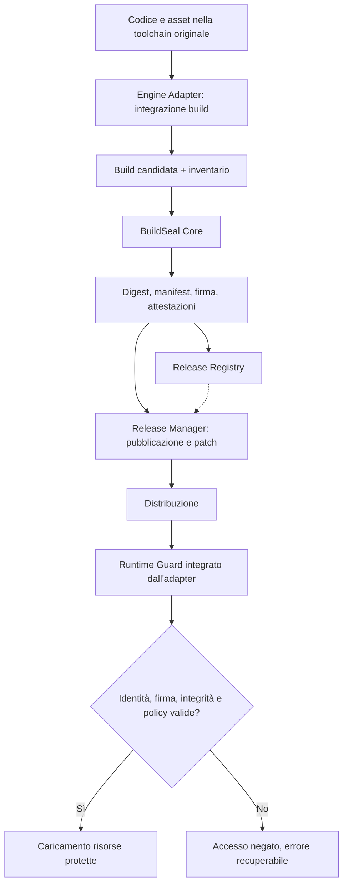

# BuildSeal — Abstract e rapporto tecnico di fattibilità

**Versione:** 0.3 — documento di discussione per peer review\
**Data:** 30 ottobre 2026  
**Stato:** proposta pre-sviluppo; nessun prototipo o benchmark ancora realizzato  
**Destinatari:** professionisti di cybersecurity, reverse engineering, software supply-chain security, crittografia applicata, sviluppo e distribuzione di videogiochi  
**Oggetto:** BuildSeal, proposta per identità, provenienza e integrità delle release, con protezione runtime sperimentale e ricerca media autonoma.

> **Scopo del documento.** Presentare la proposta nel modo più rigoroso possibile, distinguendo decisioni progettuali, ipotesi tecniche e limiti noti. Si richiede una critica competente **prima** della realizzazione del software. Non è un white paper di un prodotto esistente né una rivendicazione di inviolabilità.

## Abstract

BuildSeal è una proposta di **toolchain per identità, provenienza e integrità delle release di videogiochi indipendenti**. Il nucleo previsto collega inventario, manifest firmati, attestazioni e genealogia di baseline, patch e hotfix mediante un Core indipendente dal motore e adapter specifici. Il valore da verificare è rendere queste pratiche accessibili e coerenti nelle pipeline degli studi indipendenti, riutilizzando standard esistenti. Originalità crittografica e utilità commerciale non sono dimostrate.

Il problema di riferimento è riconoscere artefatti ufficiali, rilevare alterazioni e combinazioni incoerenti e documentare la provenienza. Firma e attestazioni non certificano che una build sia innocua: una pipeline compromessa può firmare contenuti malevoli. Il verificatore indipendente e il runtime modificabile hanno confini di fiducia distinti.

Un profilo **Protected**, facoltativo e sperimentale, studia se cifratura selettiva e Runtime Guard aumentino il costo pratico dell'estrazione rispetto alle protezioni native dei motori. Non garantisce segretezza permanente o enforcement su un client completamente controllato dall'attaccante. Una variante Connected cambia il modello di fiducia soltanto per segreti e operazioni effettivamente mantenuti sul server. La ricostruzione da screenshot e video è fuori dalla promessa di BuildSeal; provenienza dei media e watermark appartengono a una ricerca autonoma.

Questa revisione 0.3 incorpora criticità emerse dalla peer review: origine delle chiavi, dump dinamico, collusione tra copie, riutilizzabilità degli estrattori, adozione per canale e costo degli aggiornamenti. **Non esistono ancora prototipi, benchmark o risultati di protezione.** Lo scopo è identificare ciò che vale la pena sperimentare e ciò che conviene abbandonare.

## 1. Origine del problema e obiettivi

Il problema nasce dalla tensione tra necessità di promuovere pubblicamente un videogioco ancora in sviluppo e rischio che terzi ne riproducano contenuti, aspetto o funzionamento. È utile classificare gli attacchi anziché attribuirli genericamente all'“AI”:

| Scenario | Materiale disponibile all'attaccante | Possibile risultato | Ambito |
|---|---|---|---|
| Ricostruzione da preview | Screenshot, trailer, gameplay registrato | Replica grafica o funzionale indipendente | Applicativo media; **non** BuildSeal |
| Riutilizzo di asset | Sprite, texture, audio, pacchetti estratti | Copia o trasformazione di contenuti originali | Entrambi, con meccanismi diversi |
| Reverse engineering | Eseguibile, pacchetti, asset, runtime | Estrazione, modifica o ripackaging | **BuildSeal** |
| Distribuzione alterata | Build e patch ufficiali | Mix di versioni, pacchetti contraffatti, aggiornamenti manomessi | **BuildSeal** |
| Replica delle meccaniche | Osservazione e descrizione del gameplay | Implementazione nuova senza file originali | Nessuna protezione tecnica diretta garantita |

**Obiettivi prioritari di BuildSeal:**

1. Rendere ogni release ufficiale **identificabile e verificabile da un soggetto indipendente**, subordinatamente alla fiducia nella chiave del firmatario.
2. Imporre una fase esplicita di **sigillatura e promozione** attraverso la quale passano baseline, patch e hotfix.
3. Documentare la **genealogia delle release** e verificare le transizioni consentite durante gli aggiornamenti.
4. Integrare una **verifica runtime** che condizioni il normale accesso ad alcune risorse protette alla coerenza del pacchetto.
5. Consentire **marcatori forensi** di progetto, release e distribuzione, distinguendo l'indizio tecnico dalla prova legale.
6. Rimanere utilizzabile da studi indipendenti: costi, overhead e manutenzione devono essere proporzionati al beneficio.

**Non-obiettivi:** DRM dichiarato inviolabile; protezione di un'idea astratta di gameplay; cancellazione punitiva di file; telemetria occulta; identificazione automatica dell'autore di un leak; blocco indiscriminato di VM/debugger; sostituzione dei controlli della piattaforma o della legislazione sul diritto d'autore.

## 2. Principio progettuale: una release è un artefatto certificato

La compilazione riuscita non equivale alla promozione ufficiale. BuildSeal introduce un passaggio indipendente: **una build candidata diventa distribuibile soltanto dopo verifiche, sigillatura e registrazione autorizzata**. Ogni modifica successiva, anche minima, produce una nuova identità di release; una patch non può essere scambiata per una versione precedente semplicemente rinominando file o cartelle.

Il concetto originale di “file identificativi senza ruolo diretto nel gameplay, ma indispensabili al funzionamento” viene precisato in due funzioni diverse:

- **Funzione forense:** identificatori, impronte, attestazioni e legami tra versioni permettono di riconoscere una build o una sua possibile provenienza. Non è necessario che ogni indicatore sia vitale all'esecuzione.
- **Funzione di enforcement:** il runtime ufficiale valida materiali firmati e, per risorse selezionate, può richiedere informazioni crittografiche valide prima di concederne l'accesso. Non basta testare un booleano o la mera presenza di un file: il controllo dovrebbe essere parte del percorso reale di caricamento.

Le due funzioni possono condividere lo stesso registro ma non vanno confuse: **un hash identifica contenuto, una firma autentica un'affermazione rispetto a una chiave, la cifratura protegge temporaneamente la confidenzialità; nessuna delle tre garantisce da sola il comportamento di un client modificabile**.

## 3. Architettura ibrida proposta



**BuildSeal Core.** Componente universale, idealmente anche CLI, responsabile di inventario, hashing, generazione e verifica di manifest, attestazioni, packaging dei contenuti selezionati e firma. Non conosce le specifiche del gameplay.

**Engine Adapters.** Plugin o SDK per motori come Godot, Unity, Unreal, motori custom e HTML5. Collegano gli step di pre/post-build, individuano asset e punti di caricamento, dichiarano le capacità effettive del target e integrano il Runtime Guard. Le differenze tra motori impongono limitazioni diverse: non si presume compatibilità automatica.

**Runtime Guard.** Libreria o componente integrato nell'esecuzione che controlla una radice di fiducia, verifica manifest e politica di caricamento, segnala errori e autorizza l'accesso alle risorse selezionate. È soggetto a modifica e analisi sul dispositivo dell'attaccante: **non costituisce una radice di fiducia assoluta**.

**Release Registry.** Registro, locale o remoto, di Project ID, Release ID, impronte, certificati, attestazioni e relazioni fra release. È progettato per audit e verifica; l'immutabilità tecnica può essere rafforzata da append-only log o da registri trasparenti, senza presumere che il semplice database fornisca una data certa.

**Release Manager.** Gestisce promozione autorizzata, canali di distribuzione, patch, aggiornamenti atomici, recupero, rollback deliberato, revoca e compatibilità tra versioni.

**Struttura generale:** Core universale + contratti di interfaccia + adapter per target + policy dichiarative, evitando che gli adapter promettano protezioni impossibili sulla piattaforma interessata.

## 4. Identità multilivello e provenienza

| Identificativo | Persistenza | Significato |
|---|---|---|
| **Project ID** | Stabile attraverso lo sviluppo | Identità logica dell'opera, associata a una o più chiavi pubbliche autorizzate |
| **Release ID** | Nuovo a ogni artefatto sigillato | Identità specifica della build, del manifest e delle attestazioni |
| **Distribution ID** | Facoltativo per lotto/canale/tester | Indizio forense per differenziare pacchetti distribuiti; non identifica automaticamente una persona |

**Ulteriori dati possibili:** commit sorgente (quando appropriato e non sensibile), builder e ambiente dichiarati, hash SHA-256 dei componenti, algoritmo e key ID, asset inventory, Release ID dei predecessori autorizzati, versione del formato, policy, piattaforma e capacità dell'adapter, timestamp attendibile opzionale.

I riferimenti forensi possono essere duplicati in porzioni diverse del pacchetto per aumentarne la persistenza. Ma un attaccante può rimuoverli o ricompilare l'applicazione. Il recupero di un marcatore prova al massimo una **corrispondenza tecnica da contestualizzare**: non attribuisce automaticamente una responsabilità personale né prova il diritto d'autore.

**Collusione e trapianto dei marcatori.** Il confronto tra due copie differenziate può rivelare i campi variabili, consentirne rimozione o sostituzione o produrre copie ibride. Un Distribution ID semplice non è fingerprinting resistente alla collusione. Testare confronti tra copie, trapianto e perdita dei marker; eventuali codici resistenti alla collusione richiedono ricerca separata su payload, numero di copie e falsi positivi. Nessun marcatore attribuisce automaticamente una responsabilità personale.

**Esempio puramente concettuale di manifest (non uno schema definitivo):**

```json
{
  "schema_version": "draft-0.1",
  "project_id": "urn:uuid:<project-uuid>",
  "release_id": "urn:uuid:<release-uuid>",
  "version": "1.0.1",
  "target": "windows-x64",
  "parent_release_ids": ["urn:uuid:<previous-release-uuid>"],
  "signing_key_id": "developer-key-01",
  "files": [
    {"path": "assets/core.pack", "sha256": "<hex-digest>", "protected": true}
  ],
  "attestation_ref": "<attestation-reference>"
}
```

La firma deve coprire una rappresentazione **canonica e non ambigua** del payload, evitando riferimenti ricorsivi (il manifest non include l'hash della propria firma). Sono da definire canonicalizzazione, gestione dei path, symlink, file opzionali, formati degli hash, API di verifica e rotazione/revoca delle chiavi.

## 5. Gestione delle chiavi, garanzie crittografiche e runtime sperimentale

### 5.1 Garanzie da tenere separate

- **Hash:** identificano il contenuto rispetto a un riferimento attendibile; da soli non identificano il produttore.
- **Firma del manifest:** autentica una dichiarazione rispetto alla chiave di firma fidata. La chiave privata di firma resta nella pipeline, separata dalle chiavi di cifratura; non viene distribuita al gioco.
- **Cifratura autenticata (AEAD):** protegge confidenzialità e integrità simmetrica sotto una chiave segreta. Chi compromette quella chiave può produrre nuovi ciphertext con tag validi; il tag non equivale alla firma del produttore.
- **Runtime Guard:** applica la policy nel percorso ufficiale, ma un client ostile può modificarlo o sostituirlo. Una firma valida non obbliga un verificatore manomesso a rispettarla.

### 5.2 Origine e disponibilità delle chiavi

| Profilo | Origine e disponibilità | Garanzia e limite |
|---|---|---|
| Standard offline | Nessuna chiave di contenuto; chiave pubblica di verifica distribuita, chiave privata di firma nella pipeline | Integrità e provenienza verificabili rispetto a una radice di fiducia autentica; verificatore locale sostituibile |
| Protected offline, ipotesi di laboratorio | Chiave di contenuto casuale generata durante la sigillatura, consegnata o ricostruita dal loader tramite materiale disponibile al client | Barriera all'estrazione immediata; chiave e plaintext restano recuperabili da chi controlla il client |
| Connected facoltativo | Segreto di autorizzazione o operazione mantenuto sul servizio; eventuali chiavi di contenuto consegnate solo dopo autorizzazione | Le chiavi e i dati consegnati al client rimangono catturabili; ciò che resta esclusivamente sul server ha un diverso confine di fiducia |

**Ipotesi minima esplicita per il primo Protected PoC:** una chiave casuale per contenitore protetto, con un meccanismo di consegna locale documentato e deliberatamente analizzabile. Se incorporata nel binario, va testata l'estrazione statica; qualunque offuscamento deve essere descritto come tale. Non è uno schema approvato per produzione. Identificativi di macchina invasivi restano esclusi come previsto dal §8.

Prima di implementare, il PoC deve fissare generazione, conservazione, consegna, durata in memoria, gestione degli errori, rotazione e raggio di compromissione delle chiavi. Non deve distribuire il master dell'intero progetto se può consegnare chiavi limitate a una risorsa o release. La cancellazione best-effort della memoria non garantisce che copie precedenti non siano state osservate.

### 5.3 Derivazione e legame con l'identità

Un possibile schema di laboratorio usa **HKDF** con materiale iniziale segreto e casuale, salt e contesto espliciti. Project ID, Release ID, resource ID, versione del formato e scopo della chiave possono entrare in un campo `info` con codifica canonica e lunghezze non ambigue. **HKDF non trasforma dati pubblici in un segreto.** Hash del codice, manifest e firma pubblica non bastano a creare una chiave riservata.

Il master deve restare nella pipeline; il client riceverebbe soltanto il materiale necessario al proprio contenuto. Questo limita il raggio di compromissione, ma non rende segrete le risorse effettivamente decifrabili offline. Separare chiavi di firma e cifratura e non ricavare chiavi segrete da una firma pubblicata.

Una variante sperimentale può legare la derivazione a hash di codice e manifest: modificare i byte misurati cambia il risultato. Occorre però definire quali byte siano coperti ed evitare dipendenze circolari nel packaging. L'attaccante può usare una copia intatta, falsificare la misura o intercettare la chiave. **Il key-entanglement è un'ipotesi comparativa, non una nuova radice di fiducia.** Si mantiene solo se migliora i risultati rispetto a un loader più semplice.

### 5.4 Nonce, algoritmi e caricamento

AES-GCM richiede unicità della coppia chiave–nonce per messaggi distinti, anche dopo retry, build parallele e nuova sigillatura. La derivazione deve includere una versione del contenuto o cambiare chiave quando una risorsa cambia; il solo nome della risorsa non basta a gestire le ricifrature. Servono regole verificabili di allocazione dei nonce, limiti d'uso e test di ricompilazione. Non si deve ottenere deduplicazione riutilizzando in modo improprio chiavi e nonce.

XChaCha20-Poly1305 offre nonce più lunghi utili per allocazione casuale, ma non è automaticamente resistente al loro riuso. AES-GCM-SIV è una distinta alternativa da valutare per resistenza al misuse, con limiti propri e supporto della libreria da verificare. La documentazione libsodium citata non viene assunta come prova di supporto ad AES-GCM-SIV. Nessun algoritmo è selezionato definitivamente.

Il percorso ufficiale previsto è: verifica del manifest firmato e dei digest dei contenitori → verifica di identità e compatibilità → ottenimento della chiave → verifica AEAD e decifratura → consegna al resource manager. Metadati contestuali possono essere autenticati come AAD; ciò non li rende segreti e non sostituisce la firma. Plaintext non autenticato non deve essere esposto al motore. Un errore nega solo la risorsa protetta e consente riparazione, senza cancellazione dei dati utente. I messaggi utente devono aiutare il recupero senza esporre segreti; la diagnostica dettagliata va prevista per sviluppo e assistenza. La riduzione dei dettagli non è una barriera di sicurezza.

### 5.5 Attacchi prioritari e packaging

Il test deve cercare estrazione statica, intercettazione delle chiavi, dump all'uscita del loader, patch del loader/Guard e sostituzione del verificatore. Un hook può intercettare molte risorse, ma la copertura dipende dai percorsi eseguiti: recuperare un asset non dimostra un'estrazione completa. Acquisire framebuffer o audio recupera una rappresentazione fruibile, non necessariamente i file e la struttura originali.

La metrica comprende primo asset, estrazione completa, fedeltà, tempo per un estrattore automatizzato e riutilizzo su release e giochi differenti. La diversificazione può limitare il riutilizzo, ma il suo costo per lo sviluppatore deve essere misurato.

**Comprimi prima di cifrare**, quando la compressione è utile. Ricifrare un grande contenitore con nuova chiave o nonce può cambiare molti byte e peggiorare delta e deduplicazione. Confrontare contenitori monolitici, risorse separate e chunk autenticati indipendentemente, misurando byte scaricati, spazio di staging e tempi di patch. Chiavi nuove per release e riuso dei chunk invariati sono scelte in tensione, da esplicitare. Una progettazione a chunk deve autenticare anche inventario, ordine e contesto per impedire mix non autorizzati.

## 6. Lifecycle, patch e aggiornamenti

**Stati ipotizzati:** `Development → Candidate → Verified → Sealed → Released`, con percorsi distinti per build respinte, revocate, superseded e rollback autorizzati. `Verified` richiede controlli espliciti; `Sealed` significa artefatto immutabile e firmato; `Released` implica una decisione di distribuzione autorizzata.

Ogni patch dichiara almeno **stato di origine**, **stato di destinazione**, **digest degli artefatti**, **compatibilità** e **firma valida**. La procedura di aggiornamento prevista è: verifica preliminare → applicazione in staging → nuova verifica → sostituzione atomica quando possibile → recupero della versione integra in caso di errore. La combinazione non autorizzata di componenti di release differenti deve essere rilevata.

Per proteggere dagli attacchi di rollback, freeze, mix-and-match e compromissione del repository di update, occorre **studiare l'integrazione con TUF**, anziché realizzare un updater crittografico improvvisato. Per provenienza e attestazioni vanno valutati **in-toto, SLSA e Sigstore**. La firma di BuildSeal non sostituisce la code signing del sistema operativo o delle piattaforme di distribuzione.

## 7. Modello di minaccia e confini di fiducia

**Beni da proteggere:** identità delle release, autenticità delle patch, asset proprietari, integrità degli archivi, chiavi private di firma, attestazioni e disponibilità del gioco agli utenti legittimi.

**Avversari da considerare:** estrattore opportunista di asset; redistributore di pacchetti modificati; reverse engineer motivato che controlla il client; aggressore che può manomettere l'hosting degli aggiornamenti; insider con accesso parziale alla pipeline. Questi attaccanti hanno capacità e costi differenti.

**Confini principali:**

- **Build machine / CI:** la compromissione della toolchain o del sistema di firma può produrre artefatti malevoli perfettamente firmati. Servono autorizzazioni, audit e isolamento delle chiavi.
- **Registry / update host:** non bisogna considerare affidabili i metadati soltanto perché provengono dal proprio server. Il client deve verificarne autenticità e freschezza secondo una policy robusta.
- **Client finale:** va considerato **non fidato** nel modello forte. L'attaccante può osservare memoria, sostituire file, modificare verificatori e analizzare traffico.
- **Servizio di autorizzazione:** può proteggere chiavi o logica non consegnate al client, ma introduce problemi di disponibilità, abuso delle credenziali e privacy.

**Attacchi che il sistema dovrebbe rilevare nel proprio percorso ufficiale:** file modificato, manifest contraffatto, chiave non attendibile, patch con parent sbagliato, resource swap, mix di versioni, downgrade non autorizzato. **Attacchi non garantiti come impediti:** rimozione del Guard, dumping in memoria, replica da zero, modifica della logica di verifica, clonazione grafica senza asset originali, attacchi sulla toolchain compromessa.

## 8. Vincoli etici, operativi e di privacy

L'idea iniziale di rendere un pacchetto inutilizzabile cancellandone i file è stata scartata come meccanismo di protezione: è distruttiva, facilmente soggetta a falsi positivi e non assicura maggiore resistenza. Il comportamento desiderato è **fail closed limitatamente alle risorse protette**, con messaggio chiaro, meccanismi di riparazione e integrità dei dati utente.

Non si propone l'uso occulto di seriali del computer, impronte hardware invasive, ping identificativi non dichiarati o la classificazione automatica di una macchina virtuale come ambiente malevolo. VM, debugger e strumenti di accessibilità sono anche strumenti perfettamente legittimi. Eventuali verifiche di piattaforma devono essere dichiarate, proporzionate, facoltative quando possibile e sottoposte ad analisi legale e privacy.

Ulteriori requisiti: evitare online-only obbligatorio per il profilo Standard; prevedere archiviazione del gioco, continuità d'uso e disponibilità del servizio; supportare mod autorizzate tramite namespace espliciti; minimizzare impatti su performance, modding, accessibilità, assistenza e game preservation.

## 9. Distinzione tra piattaforme

| Ambiente | Capacità proposte | Limiti specifici |
|---|---|---|
| Windows/Linux/macOS nativi | Firma, digest, loader integrato, cifratura selettiva | Client analizzabile, strumenti e formati variabili |
| Unity/Godot/Unreal | Adapter di build e integrazione runtime | Costi di manutenzione su versioni e pipeline differenti |
| Motore personalizzato | Integrazione stretta nel resource manager | Richiede SDK e lavoro dello sviluppatore |
| HTML5/browser | Manifest, integrità, inventario, accesso condizionato dove applicabile | JavaScript/WASM e asset necessari arrivano al browser, ambiente completamente ispezionabile |
| Online con backend affidabile | Chiavi/operazioni o stato critico lato server | Costo, latenza, disponibilità, privacy, manutenzione |

**Decisione proposta:** il Core deve offrire un modello di *capabilities* dichiarate; ciascun adapter dichiara quali controlli può realmente implementare. Una configurazione che richiede una capacità non presente deve essere rifiutata o esplicitamente degradata, mai presentata come equivalenza di sicurezza.

## 10. Ricerca autonoma su provenienza dei media

La ricostruzione da preview è **fuori dall'ambito di protezione di BuildSeal**. Un eventuale progetto media avrà un proprio documento, threat model, piano sperimentale e criteri go/no-go. Qui resta soltanto il confine di interoperabilità: Project ID, riferimenti agli asset e attestazioni possono collegare media e release senza confonderne le garanzie.

Provenienza firmata, C2PA e watermark possono essere valutati per attribuzione e tracciabilità, verificando separatamente cosa sopravvive a rimozione di metadati, ricodifica, crop e screen capture. Non provano automaticamente titolarità o responsabilità di una persona e non impediscono la copia.

L'eventuale ricerca su perturbazioni o interpretazione multimodale non è una funzione promessa, un requisito o una fase di validazione di BuildSeal. Richiede prove autorizzate, riproducibili e specifiche per modello e pipeline; un effetto osservato non dimostra robustezza generale o prevenzione della ricostruzione.

## 11. Piano sperimentale e criteri di decisione

**Ordine proposto:** review e definizione del threat model → piccolo test anticipato del rischio Protected → MVP di provenienza → aggiornamenti dove necessari → adapter reale. Il test anticipato deve limitare l'investimento nell'ipotesi più fragile; non sostituisce una corretta implementazione di firma e verifica.

| Fase | Esperimento | Criterio di valutazione |
|---|---|---|
| 0 — Review e adozione | Definire utenti, canali, chi verifica e servizi già presenti | Esiste un problema concreto non coperto dalla pipeline attuale? |
| 1 — Confronto Protected anticipato | Stesso gioco e asset: A pacchetto ordinario + firma/verifier; B A + protezione nativa del motore; C A + Guard e cifratura selettiva | C aggiunge un beneficio pratico rispetto a B? Un XOR può essere solo un controllo didattico opzionale |
| 2 — Provenance MVP | Manifest, firma, chiave non fidata, file sostituito, pipeline compromessa simulata | Distinguere integrità dell'artefatto, autenticità del firmatario e affidabilità del builder |
| 3 — Update MVP facoltativo | A→B, mix di versioni, rollback, revoca e interruzione | Verifica, recupero e costo dei download; evitare duplicazione dell'updater dello store |
| 4 — Adapter | Un motore reale e un confronto HTML5 | Costo di integrazione, capacità effettive e manutenzione |
| Variante Connected | Confronto con C, se giustificato | Quali segreti/operazioni restano sul server e quali diventano nuovamente esposti? |

**Tre percorsi d'attacco autorizzati:** estrazione statica senza esecuzione; dump dinamico del contenuto caricato; patch del loader o delle verifiche. Usare gli stessi asset e dichiarare competenze, conoscenza iniziale, accesso al sorgente, strumenti, hardware e budget di tempo. Separare analisi white-box e black-box. Riportare tentativi falliti e limiti di copertura; un timeout è un risultato censurato, non prova di inviolabilità.

**Metriche di estrazione:** tempo al primo asset e all'estrazione completa; percentuale e qualità delle risorse recuperate; sviluppo e facilità d'uso di un estrattore automatico; riutilizzo tra release, progetti e adapter; efficacia e costo della diversificazione. Eseguire anche confronto tra copie con Distribution ID differenti e tentativi di rimozione o trapianto dei marcatori.

**Metriche operative:** falsi positivi/negativi, startup, memoria, frame time, build time, byte di patch rispetto alla baseline nativa, staging, ripristino, compatibilità con mod autorizzate e disponibilità offline. Prima del test fissare soglie accettabili insieme agli sviluppatori del target, evitando soglie inventate dopo i risultati.

**Go/no-go separati:** ridurre o abbandonare Protected se non migliora la baseline nativa quanto richiesto o introduce costi inaccettabili. Valutare indipendentemente se provenienza e gestione delle release offrano un beneficio operativo sufficiente: la loro fattibilità tecnica non dimostra domanda commerciale. Nessuna percentuale di protezione, tempo di crack o superiorità è dichiarata prima delle misure.

## 12. Domande per i revisori

1. È tecnicamente sensato tentare di vincolare una risorsa indispensabile a un manifest firmato, sapendo che il client è interamente controllabile?
2. Quali verifiche dovrebbero essere indipendenti dal runtime e quali possono risiedere nel motore?
3. Cosa aggiungerebbe davvero la cifratura selettiva rispetto a code signing, hash e updater sicuro?
4. Come modellare senza ambiguità una catena di baseline, patch, rollback autorizzati e revoche?
5. Qual è il primo bypass realistico da testare su un PoC autorizzato, e quale costo dovremmo misurare?
6. Quali elementi di TUF, in-toto, SLSA e Sigstore conviene adottare anziché riscrivere?
7. Quale modello minimo di key management è accettabile per un indie senza HSM o infrastrutture dedicate?
8. Quali vincoli impongono le piattaforme di distribuzione, gli store e i motori più diffusi?
9. Come evitare che il Runtime Guard rompa modding, strumenti di sviluppo, accessibilità o conservazione del software?
10. I Distribution ID hanno valore forense sufficiente a giustificare packaging differenziato e rischio di attribuzioni errate?
11. Quali risultati sperimentali dovrebbero farci **interrompere** lo sviluppo del profilo anti-tamper?
12. Il confine con il progetto media autonomo è chiaro e quali soli riferimenti di provenienza meritano interoperabilità?

## 13. Direzioni condivise, decisioni aperte e primo deliverable

**Direzioni condivise:** Core e adapter; identità multilivello; integrità e provenienza verificabili; nuova identità per ogni release sigillata; comportamento non distruttivo; nessuna telemetria occulta; progetto media autonomo. Protected resta opzionale e sperimentale. Il Release Manager è modulare e non deve sostituire servizi di distribuzione già adeguati.

**Decisioni aperte:** target del PoC; formato e canonicalizzazione del manifest; trust root e bootstrap; generazione, consegna e rotazione delle chiavi; algoritmi e contenitori; granularità e costo delle patch; modello Connected; API degli adapter; modding; compatibilità con piattaforme e licenze dei futuri componenti. Il file LICENSE attuale non viene modificato da questa revisione.

**Primo deliverable:** threat model corretto, matrice di adozione verificata e protocollo preregistrato del confronto A/B/C del §11, con eventuale variante Connected. Il report dei risultati deve distinguere benefici misurati, fallimenti, effetti collaterali e ipotesi ancora non verificate.

## 14. Riferimenti tecnici per approfondimento

I seguenti riferimenti descrivono standard o pratiche pertinenti; **non** attestano che BuildSeal li implementi o sia conforme a essi.

- **The Update Framework (TUF):** [specifica ufficiale](https://theupdateframework.github.io/specification/v1.0.36/) — aggiornamenti attendibili, protezioni contro rollback/freeze/mix-and-match.
- **in-toto Attestation Framework:** [specifica e repository](https://github.com/in-toto/attestation) — attestazioni di processo e artefatto.
- **SLSA Build Provenance:** [specifica](https://slsa.dev/spec/v1.0/provenance) — origine e processo della build.
- **Sigstore:** [documentazione](https://docs.sigstore.dev/) — firma e verifica di artefatti e attestazioni.
- **OWASP MASVS-RESILIENCE:** [riferimento](https://mas.owasp.org/MASVS/11-MASVS-RESILIENCE/) — ruolo e limiti di anti-tamper, obfuscation e anti-debug.
- **NIST SP 800-38D:** [Galois/Counter Mode (GCM)](https://csrc.nist.gov/pubs/sp/800/38/d/final) — cifratura autenticata.
- **RFC 3161:** [Time-Stamp Protocol](https://www.rfc-editor.org/rfc/rfc3161) — marche temporali attendibili.
- **C2PA:** [specifiche ufficiali](https://spec.c2pa.org/specifications/) — provenienza dei media, binding e watermark.

- **HKDF:** [RFC 5869](https://www.rfc-editor.org/rfc/rfc5869) — derivazione extract-and-expand; il contesto pubblico non è materiale segreto.
- **AEAD APIs:** [libsodium documentation](https://doc.libsodium.org/secret-key_cryptography/aead) — algoritmi, requisiti dei nonce e vincoli di implementazione.
- **AES-GCM-SIV:** [RFC 8452](https://www.rfc-editor.org/rfc/rfc8452) — cifratura autenticata resistente al riuso dei nonce; nessuna implementazione dichiarata.

## 15. Adozione, verificatori e canali di distribuzione

La seguente matrice è un'ipotesi di adozione da verificare con utenti reali e documentazione dei singoli canali, non una dichiarazione di compatibilità.

| Scenario | Chi verifica e dove | Valore da dimostrare / duplicazione da evitare |
|---|---|---|
| CI e promozione interna | Builder, release engineer e verificatore indipendente | Inventario, attestazioni, approvazioni e identità coerenti; una CI compromessa resta una minaccia |
| Playtest e consegna diretta | Studio, tester o verificatore esterno con radice di fiducia autentica | Integrità del pacchetto e correlazione forense; updater solo se necessario |
| Store PC, incluso Steam o itch.io | Store per i servizi effettivamente offerti; studio/revisore per attestazioni proprie | Verificare servizi e API per canale; non assumere identità tra store o firma del produttore fornita automaticamente |
| Console o piattaforme gestite | Toolchain e meccanismi autorizzati dalla piattaforma | Valore iniziale nella pipeline interna; updater/Guard solo se documentazione e accordi lo consentono |
| HTML5 | Pipeline, verificatore esterno e loader del browser | Integrità e provenienza nel modello dichiarato; codice e dati utilizzati restano ispezionabili |

Per ogni scenario documentare costo attuale, soggetto che usa la verifica, acquisizione della chiave pubblica autentica, comportamento in caso di revoca e beneficio rispetto ai servizi esistenti. TUF riguarda il percorso di aggiornamento gestito da BuildSeal, quando presente; non viene imposto come secondo updater sopra uno store. Nessuna attestazione supplisce automaticamente alla compromissione del builder o della chiave di firma.

## 16. Related work e confronti necessari

| Famiglia / fonte primaria | Collegamento con BuildSeal | Confronto richiesto |
|---|---|---|
| [Godot: cifratura PCK](https://docs.godotengine.org/en/stable/engine_details/development/compiling/compiling_with_script_encryption_key.html) | Cifratura dei pack con materiale disponibile al runtime | Baseline nativa per estrazione statica, dump e costo di integrazione |
| [Steam DRM](https://partner.steamgames.com/doc/features/drm) | Wrapper DRM; Valve ne dichiara i limiti contro attaccanti motivati | Distinguere controllo d'accesso, protezione del codice e provenienza |
| [SteamPipe](https://partner.steamgames.com/doc/sdk/uploading) | Packaging e aggiornamenti; attenzione alla località delle modifiche | Patch cifrate/compresse, chunk e byte effettivamente scaricati |
| [Denuvo / Irdeto](https://irdeto.com/video-games) | Famiglia di protezioni commerciali per videogiochi | Obiettivi, integrazione e requisiti; nessuna equivalenza o superiorità presunta |
| [VMProtect](https://www.vmpsoft.com/vmprotect/overview) e [Themida / Oreans](https://www.oreans.com/products.php) | Protezione del codice e contrasto all'analisi | Costi, compatibilità e differenza rispetto a inventario e attestazioni |
| TUF, in-toto, SLSA, Sigstore (§14) | Aggiornamenti, attestazioni e provenienza | Riutilizzare standard; individuare il solo valore aggiunto dell'integrazione nei motori |

Le fonti dei produttori descrivono funzionalità e obiettivi, non costituiscono benchmark indipendenti. Costi, falsi positivi, overhead e bypass di prodotti esistenti richiedono casi documentati e condizioni confrontabili; questa revisione non attribuisce valori o incidenti senza evidenza. Non si propone di adottare indiscriminatamente controlli anti-VM o anti-debug contrari al §8.

## 17. Licenza attuale e futura separazione dei componenti

Il repository contiene una [LICENSE GPL-3.0](LICENSE), che questa revisione **non modifica**. La documentazione descrive componenti futuri, non un SDK già distribuito. Prima di accettare codice o distribuire il Guard occorre definire licenze e confini di documentazione, CLI/Core, adapter, runtime e dipendenze.

La GPL consente attività commerciali; il problema da valutare è la combinazione con software proprietario. Le [FAQ GNU](https://www.gnu.org/licenses/gpl-faq.html#LinkingWithGPL) distinguono linking in un'opera combinata dall'uso di programmi separati. Un Core eseguito nella pipeline non rende automaticamente GPL i file del gioco; codice GPL incorporato o linkato richiede una diversa valutazione. LGPL, MPL, Apache o un'eccezione esplicita sono opzioni con obblighi differenti, non sostituti equivalenti. Nessuna di queste è adottata implicitamente qui. La scelta deve essere coerente con integrazione tecnica, distribuzione e licenze delle dipendenze.

---

**Invito alla revisione.** Sono particolarmente utili osservazioni circostanziate che identifichino una precondizione falsa, un attacco non considerato, uno standard da riutilizzare, un costo operativo sottovalutato o un piccolo esperimento capace di confutare una delle ipotesi. Lo scopo è determinare **se** e **quale parte** valga la pena costruire, prima di costruirla.
